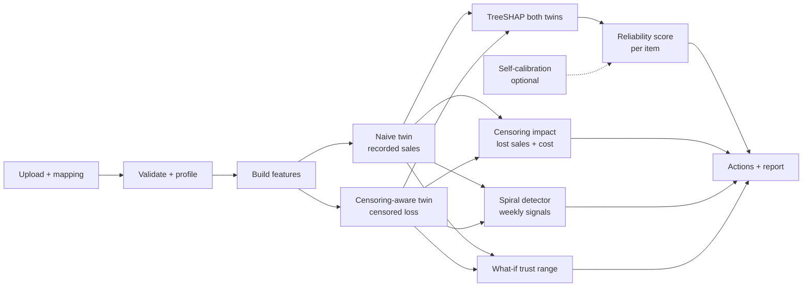
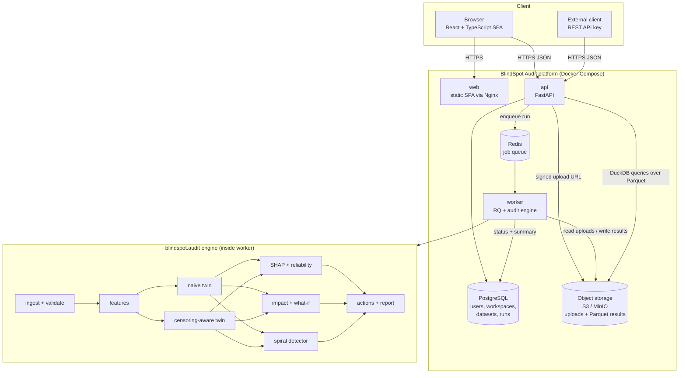
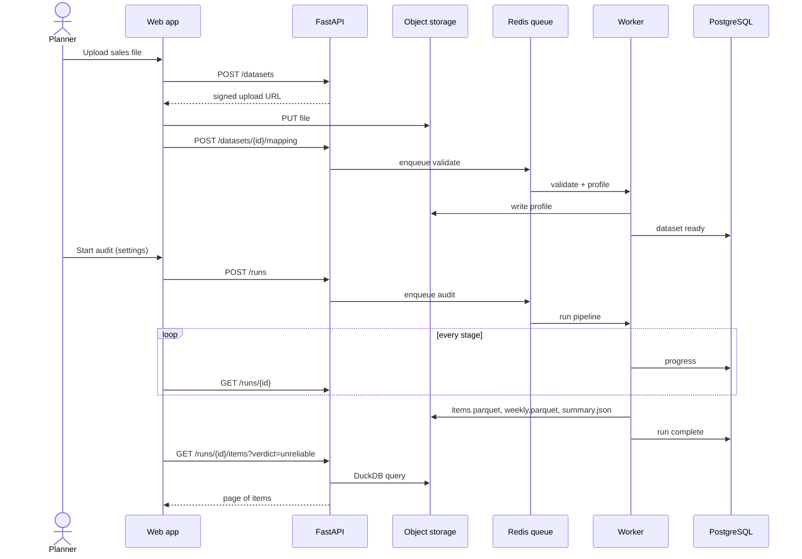
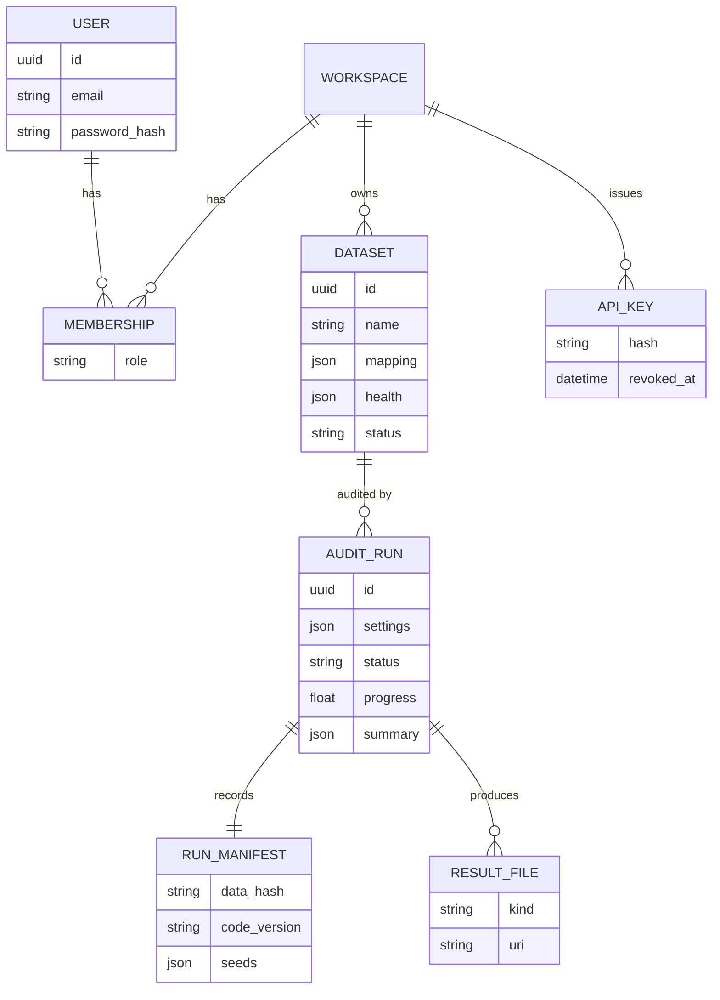
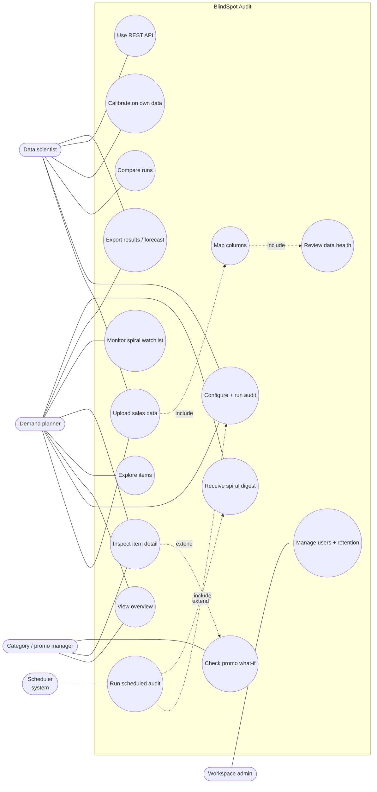

# BlindSpot Audit — Phase 2 Product Design

*Draft design for the Phase 2 product: an independent check of a retailer's demand forecasts under stockout
censoring, with a stockout-spiral alert built in. Nothing here is built yet.*

UI wireframes (Section 5.2): **https://claude.ai/artifact/FWyxuxzML9cnJdLPskGAPw**

---

## 1. Product in one paragraph

A retailer uploads daily sales, stockout records and promotions (plus, if they have them, their own forecasts,
orders and unit economics). BlindSpot Audit trains two models side by side: a **naive model** on recorded
sales, which is what most forecasting systems do, and a **censoring-aware model** that treats stockout days as
lower bounds (the Step 17 censored loss). It compares the two to tell the retailer, item by item:

1. **Can this item's forecast explanation and promotion what-if be trusted?** (Step 18 reliability warning)
2. **How much is censoring costing?** (lost sales on stockout days and extra ordering cost, from the Step 10 cost model)
3. **Is this item in a stockout spiral?** Censored sales lead to a low forecast, then small orders, then more
   stockouts. (New in Phase 2.)
4. **What should be done about it?** (use the censoring-aware forecast, don't trust the promotion what-if,
   review manually, or fix the data)

It sits **alongside** the retailer's planning system (RELEX, SAP, in-house models) instead of replacing it.

### 1.1 Why each part is backed by Phase 1

| Product claim | Evidence (Phase 1) |
|---|---|
| Censoring distorts the explanation while accuracy looks fine | Step 11: WAPE +10%, promotion effect recovered 59% vs 90% |
| It is censoring, not noise | Step 14: holds under random masking and grows with the censoring rate |
| Not a sample-size artefact | Step 15: holds at 2,500 / 5,000 / 10,000 series |
| A fix exists | Step 17: censored loss closes 76% of the gap, promo recovery 89% |
| Unreliable items can be flagged **without true demand** | Step 18: model-disagreement rule AUC 0.853, gradient boosting AUC 0.858 |
| Forecasts are biased low (spiral fuel) | Step 11/14: bias -0.156 at 30% censoring, -0.241 at 50% |

**Key design consequence:** in Step 18 the simple **model-disagreement rule** (AUC 0.853) is almost as good
as the trained classifier (0.858). It needs no training labels, so it carries over to a new retailer
unchanged. The product ships the rule first. The classifier is used only after it has been recalibrated on
the customer's own data (Section 3.4, self-calibration).

---

## 2. Framework and technology stack

### 2.1 Why not Streamlit for the product

Streamlit stays as the internal research viewer. The product needs things Streamlit handles poorly:
several users and workspaces, long background jobs with progress, a multi-step upload and column-mapping
wizard, links to each page, filtering and paging tens of thousands of items quickly, and a
public API. So the product uses a separate frontend and API.

### 2.2 Stack

| Layer | Choice | Why |
|---|---|---|
| Audit engine | Python 3.13, existing `blindspot` package + new `blindspot.audit` subpackage; pandas, LightGBM, SHAP, scikit-learn | Reuses the Phase 1 code that has been tested (censored objective, SHAP agreement, newsvendor) |
| API | FastAPI + Pydantic v2, Uvicorn | Same language as the engine; typed; generates an OpenAPI spec automatically |
| Background jobs | Redis + RQ worker | Audits take minutes; RQ is simple and Python-native (Celery is overkill for the MVP) |
| Metadata DB | PostgreSQL 16 + SQLAlchemy 2 + Alembic | Users, workspaces, datasets, runs, settings |
| Result storage | Parquet per run on object storage (local disk in dev, S3/MinIO in prod), queried with DuckDB | Item tables of 50k+ rows filter and page fast without loading into Postgres |
| Frontend | React 19 + TypeScript + Vite, React Router | Single-page app; no SEO need, so no Next.js server |
| UI kit | Tailwind CSS + shadcn/ui (Radix primitives) | Accessible components, consistent look |
| Data fetching / tables | TanStack Query + TanStack Table (server-side paging) | Large item lists, caching, retries |
| Charts | Apache ECharts (`echarts-for-react`) | Time series with shaded stockout bands, large point counts, SHAP bar comparisons |
| API client | `openapi-typescript` generated from the FastAPI spec | Frontend and backend types can't drift |
| Auth | Email + password with HTTP-only session cookies (`fastapi-users`); SSO (OIDC) later | Simple MVP, upgradeable |
| Reports | HTML template → PDF with WeasyPrint; CSV/XLSX exports | A short summary document for managers |
| Packaging | Docker Compose: `web`, `api`, `worker`, `postgres`, `redis`, `minio` | One command to run everything |
| Quality | pytest, ruff, mypy; Vitest + Testing Library; Playwright end-to-end; GitHub Actions CI | Same "ALL CHECKS PASSED" culture as Phase 1 |

### 2.3 Repository layout (proposed)

```
src/blindspot/            Phase 1 research code (unchanged)
src/blindspot/audit/      Phase 2 engine (dataset-agnostic)
    schema.py             input data contract + validation
    ingest.py             CSV/Parquet reading, column mapping, normalisation
    profile.py            data health: censoring rate, coverage, gaps
    features.py           generalised feature builder (from Phase 1 features.py)
    twins.py              naive + censoring-aware LightGBM training
    reliability.py        per-item SHAP disagreement, forecast gap, verdicts
    calibrate.py          self-calibration on the customer's own clean days
    whatif.py             promo/discount what-if trust range
    impact.py             lost sales + ordering cost of censoring
    spiral.py             stockout-spiral detector
    actions.py            recommended action per item
    pipeline.py           runs the stages, writes the run manifest
api/                      FastAPI app (routers, models, jobs)
web/                      React app
deploy/                   docker-compose.yml, env templates
tests/audit/, api/tests/, web/tests/
```

---

## 3. How the audit engine works

### 3.1 Input data contract

| Field | Required | Notes |
|---|---|---|
| `item_id` (or `store_id` + `product_id`) | yes | One series = one store × product |
| `date` | yes | Daily rows; gaps allowed and reported |
| `units_sold` | yes | Recorded (possibly censored) sales |
| Stockout signal | yes, **one of** | daily `stockout_flag`; `hours_out_of_stock`; hourly stock status; or end-of-day `on_hand = 0` |
| `on_promo`, `discount` | recommended | Needed for the promotion what-if |
| `price`, `unit_cost` | optional | Converts cost units into money |
| `their_forecast`, `order_qty`, `on_hand` | optional | Lets the audit check the retailer's **own** forecasts and orders directly (forecast gap, spiral on real orders) |
| `hourly_sales` | optional | Better lost-sales estimate (Step 17 imputation) |
| Store/product attributes, holidays, weather | optional | Extra features |

Minimum history: 8 weeks of daily data per item (12+ recommended). An item with no stockout-free days, or
fewer than 28 days, gets **"insufficient data"** instead of a verdict.

### 3.2 Pipeline stages



| Stage | What it does | Phase 1 code reused |
|---|---|---|
| Validate + profile | Schema checks, duplicate/gap detection, censoring rate per item and overall, items excluded and why | `prepare.py` logic |
| Features | Lags, rolling stats, calendar, promo, optional covariates; history from recorded sales; time split train / validation / recent window | `features.py` (generalised: no fixed column names) |
| Twins | Same LightGBM settings; naive on recorded sales, censored-loss on stockout days as lower bounds | `model.py`, `mitigation.train_censored` |
| Explain | TreeSHAP for both twins on the most recent 14 days of each item | `explain.shap_values`, `local_stability` |
| Reliability | `model_disagreement = 1 − mean per-row Spearman(|SHAP| naive, |SHAP| aware)`; `forecast_gap`; verdict Reliable / Check / Unreliable | `reliability.item_table` |
| What-if trust range | Promotion/discount uplift under both twins; show the interval, say which side is likely understated | `whatif.whatif` |
| Impact | Lost units on stockout days = max(0, aware forecast − recorded) (or hourly imputation); ordering cost naive vs aware at the customer's cost ratio; money if prices given | `inventory.py`, `mitigation.impute_demand` |
| Spiral | Weekly signals per item (3.5) | new |
| Actions | Rules mapping the results to a recommended action (3.6) | new |
| Report | `items.parquet`, `weekly.parquet`, `summary.json`, `manifest.json` (data hash, code version, seeds, settings) | `experiment.py` style |

### 3.3 Reliability verdict

* **Default (rule):** threshold on `model_disagreement`. The default cut-off comes from Step 18's training
  part (F1-optimal). Three bands: *Reliable* below the cut-off, *Unreliable* above a higher cut-off, *Check*
  in between, so the uncertainty is visible.
* **Calibrated (classifier):** used only after self-calibration (3.4) on this customer's data.
* Every verdict carries "why": its disagreement score, its stockout share and promo share, and the top features
  whose SHAP rank changed most between the twins.

### 3.4 Self-calibration (new)

A new retailer's data differs from FreshRetailNet, so a threshold learned on FreshRetailNet might not hold.
BlindSpot repeats the Phase 1 experiment **on the customer's own data**:

1. Take items' stockout-free days (true demand is known on those days).
2. Simulate demand-linked censoring with the customer's own stockout timing (Step 3 masking).
3. Train a "clean" model and a naive model on the masked copy. Label items as unreliable exactly as in Step 18.
4. Fit the threshold (and optionally the classifier) on these labels; report **warning quality on your data**
   (ROC AUC with CI) in the run.

This costs about 2 extra model fits. It is optional ("Calibrate" toggle) and recommended for the first audit.

### 3.5 Stockout-spiral detector (feature 2 inside the product)

Per item and week *w*, using the last 8–12 weeks:

| Signal | Definition | Spiral direction |
|---|---|---|
| S1 stockout rate | share of days (or business hours) out of stock | rising |
| S2 supply level | the retailer's orders or forecast if given; else the naive twin's forecast | falling |
| S3 censoring gap | (aware forecast − naive forecast) / aware forecast | widening |
| S4 latent demand | aware forecast level | flat or rising |

Trends use the Theil–Sen slope over the window (robust to one-off weeks). States:

* **Healthy** — fewer than two signals in spiral direction.
* **Watch** — S1 rising and at least one of S2/S3 in spiral direction.
* **Spiral** — S1 rising, S2 falling, S3 widening and S4 not falling, for 3+ consecutive weeks.

`spiral_score` (0–100) combines the standardised slopes, so the watchlist can be sorted. The thresholds above
are starting values to be tuned in the validation step (P2-6): a **closed-loop simulation** on FreshRetailNet,
where each day's stock is the order a naive policy places from its own censored history and the true
demand is known. This gives ground-truth spiral items, so the detector's precision and recall can be measured
before any customer sees it.

### 3.6 Recommended actions

| Condition | Action shown |
|---|---|
| Unreliable explanation, promo item | "Don't trust the promotion what-if; use the censoring-aware range" |
| Spiral | "Order from the censoring-aware forecast or set a minimum order; review this week" |
| Large censoring cost, reliable | "Switch this item to the censoring-aware forecast" |
| Stockout signal missing or inconsistent | "Fix data: stockout records" |
| Insufficient data | "Not enough history; re-audit after N more weeks" |

The censoring-aware forecast itself can be downloaded per item (the fix, not just the warning).

---

## 4. Requirements

### 4.1 Users (actors)

| Actor | Goal |
|---|---|
| Demand planner / replenishment analyst | Find items whose forecast or what-if is wrong, act this week |
| Category / promotion manager | Know whether promotion results and what-ifs can be trusted |
| Data scientist / forecasting owner | Audit the model, compare runs, download the censoring-aware forecast, use the API |
| Workspace admin | Manage users, data retention, settings |
| Scheduler (system) | Runs recurring audits |

### 4.2 Scope by release

| Release | Contents |
|---|---|
| **MVP** | Upload CSV/Parquet, mapping wizard, data health, audit run with progress, overview, item explorer, item detail, spiral watchlist, CSV export, single workspace |
| **v1** | Self-calibration, run comparison, PDF summary report, promo what-if checker, multiple workspaces + roles, REST API keys |
| **Later** | Scheduled audits + email digest, warehouse connectors (S3, Snowflake, BigQuery), bring-your-own model (LightGBM/XGBoost file), SSO, stockout inference from sales alone |

### 4.3 Functional Requirements

Priority: **M** = must (MVP), **S** = should (v1), **C** = could (later).

**Accounts and workspaces**
- **FR-1 (M)** The system shall let a user sign up, sign in and sign out with email and password.
- **FR-2 (S)** The system shall support workspaces, each with its own datasets, runs and members.
- **FR-3 (S)** The system shall support the roles Admin, Analyst and Viewer, with permissions enforced by the API.

**Data ingestion**
- **FR-4 (M)** The system shall accept CSV and Parquet uploads up to 2 GB, with a progress indicator.
- **FR-5 (M)** The system shall auto-detect likely column mappings (item, date, sales, stockout signal, promo) and let the user confirm or change them.
- **FR-6 (M)** The system shall accept any one of the four stockout-signal formats in Section 3.1 and convert it to a daily stockout flag and stockout-hours value.
- **FR-7 (M)** The system shall validate the data (types, duplicates, missing dates, negative sales, history length) and show a data-health report before an audit can start.
- **FR-8 (M)** The system shall show, per dataset, the overall and per-item censoring rate and list items excluded, with the reason.
- **FR-9 (C)** The system shall import data from S3, Snowflake and BigQuery on a schedule.

**Audit configuration and execution**
- **FR-10 (M)** The system shall let the user set the shortage and waste cost (or critical ratio), business hours and the recent window to explain, with defaults from Phase 1.
- **FR-11 (M)** The system shall run an audit as a background job and show its stage and progress, and let the user cancel it.
- **FR-12 (M)** The system shall train a naive model and a censoring-aware (censored-loss) model on the same features and time split.
- **FR-13 (M)** The system shall record for every run a manifest: data hash, code version, settings and random seeds, so that a run can be reproduced exactly.
- **FR-14 (S)** The system shall offer self-calibration (Section 3.4) and report warning quality (ROC AUC with 95% CI) on the customer's data.
- **FR-15 (C)** The system shall run audits on a schedule (for example weekly) for a connected dataset.

**Reliability and impact**
- **FR-16 (M)** The system shall give every eligible item a reliability verdict (Reliable / Check / Unreliable), its disagreement score, and the reasons behind it.
- **FR-17 (M)** The system shall show, per item, both twins' SHAP drivers side by side and highlight features whose rank changed most.
- **FR-18 (M)** The system shall estimate per item the units lost on stockout days and the extra ordering cost of using the naive forecast, in cost units, or in money if prices are given.
- **FR-19 (S)** The system shall show, for promotion and discount changes, the what-if uplift under both twins as a range, and say when the naive what-if is likely understated.
- **FR-20 (S)** If the customer supplies their own forecast, the system shall report its bias on stockout days versus stockout-free days and its gap to the censoring-aware forecast.

**Stockout-spiral alert**
- **FR-21 (M)** The system shall compute the weekly spiral signals (S1–S4) per item and give each item a state (Healthy / Watch / Spiral) and a spiral score.
- **FR-22 (M)** The system shall show a spiral watchlist sorted by score, with each item's weekly trend.
- **FR-23 (S)** The system shall use the customer's order quantities for signal S2 when they are provided.
- **FR-24 (C)** The system shall send an email digest when new items enter the Spiral state.

**Exploration and actions**
- **FR-25 (M)** The system shall show an overview with headline figures: items audited, share unreliable, share in spiral, estimated lost units and censoring cost.
- **FR-26 (M)** The system shall provide an item explorer with server-side filtering (verdict, spiral state, category, store, stockout share), sorting, search and paging.
- **FR-27 (M)** The system shall show an item page with the sales history (stockout days shaded), both forecasts, the SHAP comparison, the what-if range, the spiral trend and the recommended action.
- **FR-28 (M)** The system shall give each item a recommended action according to the rules in Section 3.6.
- **FR-29 (S)** The system shall compare two runs and list items whose verdict or spiral state changed.

**Outputs**
- **FR-30 (M)** The system shall export the item results and the censoring-aware forecasts as CSV.
- **FR-31 (S)** The system shall produce a PDF summary report of a run.
- **FR-32 (S)** The system shall expose the audit (upload, start run, poll status, fetch results) through a documented REST API with API keys.
- **FR-33 (M)** The system shall include a methodology page explaining what each verdict and number means and its limits.

### 4.4 Non-Functional Requirements

**Security**
- **NFR-S1** All traffic over HTTPS (TLS 1.2+); HTTP-only, Secure, SameSite cookies; CSRF protection on state-changing requests.
- **NFR-S2** Passwords hashed with Argon2id; sign-in rate limited (for example 5 failed tries per 15 min per account and IP).
- **NFR-S3** Every query and file path is scoped to the user's workspace; tests prove one workspace cannot read another's data.
- **NFR-S4** Uploaded files and results encrypted at rest (storage-level AES-256); database backups encrypted.
- **NFR-S5** Uploads accept only CSV/Parquet, checked by content, not extension; size-limited; parsed in the worker, never executed. No pickled models are accepted (bring-your-own model, when added, uses LightGBM/XGBoost text formats only).
- **NFR-S6** Admin-visible audit log of sign-ins, uploads, runs, exports and deletions.
- **NFR-S7** API keys are stored hashed, can be revoked and are scoped to one workspace.
- **NFR-S8** Dependencies scanned in CI (pip-audit, npm audit); secrets only from environment, never in the repository.

**Privacy and data handling**
- **NFR-P1** The product needs no personal data (sales are per item, not per customer); the mapping wizard warns if a column looks like personal data.
- **NFR-P2** Customer data is never used to train anything outside that customer's workspace.
- **NFR-P3** Admins can delete a dataset and all its runs; deletion is complete within 24 h, including object storage.
- **NFR-P4** Configurable retention (default 180 days).

**Performance**
- **NFR-F1** A standard audit of 5,000 items × 90 days finishes in ≤ 10 min on one 8-core / 32 GB worker; with self-calibration in ≤ 25 min. (Phase 1's Step 11 runs several such model fits in about 7 min.)
- **NFR-F2** 50,000 items finish in ≤ 90 min on one 16-core worker; jobs for different workspaces run in parallel on extra workers.
- **NFR-F3** Peak worker memory ≤ 16 GB for 50,000 items × 90 days (category dtypes, float32, chunked SHAP).
- **NFR-F4** Data validation and the health report for a 1 GB file finish in ≤ 2 min.

**Speed (interface responsiveness)**
- **NFR-R1** API p95 latency ≤ 300 ms for overview and item-explorer pages (results are precomputed; DuckDB over Parquet).
- **NFR-R2** Item page fully loaded in ≤ 1.5 s p95; filter/sort in the item explorer ≤ 500 ms p95 on 50,000 items.
- **NFR-R3** First load of the web app ≤ 2.5 s on a typical broadband connection (JS bundle ≤ 400 KB gzip, code-split per page).
- **NFR-R4** Run progress updates at least every 5 s.

**Reliability and reproducibility**
- **NFR-L1** Same data + same settings + same code version gives identical results (fixed seeds, pinned dependencies, run manifest).
- **NFR-L2** A worker crash marks the run failed with a clear message; no partial results are shown as complete; the user can retry.
- **NFR-L3** Target 99.5% monthly availability for the web app and API (MVP: single node, daily backups, restore tested).

**Honesty of outputs**
- **NFR-H1** Every estimate is labelled as an estimate; warning quality is shown with its CI; items without enough data say so instead of getting a verdict.
- **NFR-H2** The interface states that SHAP and what-if describe the model, not what causes sales.

**Usability and accessibility**
- **NFR-U1** A first-time user can go from upload to a finished audit without reading documentation (mapping wizard and defaults).
- **NFR-U2** WCAG 2.2 AA: keyboard navigation, 4.5:1 text contrast, verdicts never shown by colour alone (label + icon).
- **NFR-U3** Works on screens from 1280 px wide; overview and watchlist readable on a phone.

**Maintainability and portability**
- **NFR-M1** Engine test coverage ≥ 85%; every engine stage has a check that passes or fails visibly, as in Phase 1.
- **NFR-M2** Typed code (mypy, TypeScript strict); OpenAPI-generated client.
- **NFR-M3** Runs with `docker compose up` on Windows, macOS and Linux; no cloud service required for development.

---

## 5. Design

### 5.1 High-Level Architecture



**Request flow for one audit**



**Main API endpoints**

| Method | Path | Purpose |
|---|---|---|
| POST | `/auth/login`, `/auth/logout` | Session |
| POST | `/datasets` | Create dataset, get upload URL |
| POST | `/datasets/{id}/mapping` | Confirm columns, start validation |
| GET | `/datasets/{id}/health` | Data-health report |
| POST | `/runs` | Start audit with settings |
| GET | `/runs/{id}` | Status, progress, summary |
| DELETE | `/runs/{id}` | Cancel / delete |
| GET | `/runs/{id}/items` | Filter, sort, page item results |
| GET | `/runs/{id}/items/{item}` | Item detail: history, both forecasts, SHAP, what-if, spiral |
| GET | `/runs/{id}/spiral` | Watchlist |
| GET | `/runs/{id}/compare/{other}` | Changed verdicts |
| GET | `/runs/{id}/export.csv`, `/report.pdf` | Outputs |

**Data model (metadata in PostgreSQL)**



Per-item results (`items.parquet`, one row per item; `weekly.parquet`, one row per item × week) stay in
object storage and are queried with DuckDB.

### 5.2 Preliminary Prototype

Interactive wireframes on a design canvas: **https://claude.ai/artifact/FWyxuxzML9cnJdLPskGAPw**
(export each artboard as PNG from the canvas to insert in the report).

All figures on the wireframes are illustrative demo values for a FreshRetailNet-50K demo workspace, shaped
like the Phase 1 results. They are not results of the product.

| Screen | What it shows | Requirements |
|---|---|---|
| 1. Overview | Headline figures (items audited, share unreliable, share in spiral, lost units, censoring cost), verdict breakdown, top actions | FR-25, FR-28 |
| 2. Upload & mapping | Steps Upload → Map columns → Check data → Settings; auto-detected mapping; data-health summary | FR-4–FR-8, FR-10 |
| 3. Item explorer | Filterable table of items with verdict, spiral state, stockout share, disagreement, lost units, action | FR-16, FR-26 |
| 4. Item detail | Sales history with stockout days shaded; naive vs censoring-aware forecast; SHAP side by side; what-if range; reasons; action | FR-17–FR-19, FR-27 |
| 5. Spiral watchlist | Items in Spiral / Watch, sorted by score, with weekly trends of stockout rate, supply and censoring gap | FR-21–FR-23 |

### 5.3 Use Case Diagram



Main use case (UC4 Configure + run audit):

| | |
|---|---|
| Actor | Demand planner or data scientist |
| Precondition | A dataset with status *ready* (passed data health) |
| Main flow | 1. Choose dataset. 2. Review default settings (costs, business hours, recent window). 3. Optionally turn on self-calibration. 4. Start. 5. Watch progress by stage. 6. Land on the Overview when done. |
| Alternatives | 4a. Too few eligible items → the system explains and blocks the run. 5a. Worker failure → run marked failed with the reason; retry offered. 5b. User cancels. |
| Postcondition | Run results, manifest and summary stored; run listed in history |

---

## 6. Build plan (Phase 2 steps)

Each step is done and approved one at a time with manual tests, as in Phase 1.

| Step | Deliverable | Check |
|---|---|---|
| P2-1 | Data contract + `ingest`/`profile`: load FreshRetailNet through the generic contract | Profile matches Phase 1 Step 2 numbers |
| P2-2 | Generic features + twins (`features`, `twins`) | Reproduces Step 17 naive and censored-loss metrics on the 5,000 sample |
| P2-3 | `reliability` + `impact` + `whatif` + `actions` on generic data | Reproduces Step 18 rule AUC (0.853) |
| P2-4 | `calibrate` (self-calibration) | On a held-out store split, calibrated threshold scores ≥ default rule's AUC |
| P2-5 | `spiral` detector | Unit tests on synthetic spirals |
| P2-6 | Closed-loop simulation to validate the spiral detector | Precision/recall reported with CIs; thresholds frozen |
| P2-7 | `pipeline` + manifest + CLI (`blindspot-audit run data.csv`) | 5,000 items within NFR-F1 time |
| P2-8 | FastAPI + Postgres + Redis/RQ worker + object storage; Docker Compose | API tests incl. workspace isolation (NFR-S3) |
| P2-9 | React app: auth, upload + mapping, run progress | Playwright: upload → run |
| P2-10 | Overview, item explorer, item detail, spiral watchlist | Playwright + latency checks (NFR-R1/R2) |
| P2-11 | Exports, methodology page, PDF report | Manual review |
| P2-12 | Second dataset test (another retail dataset with stockouts, or a pilot partner) | Write-up of results |

Steps P2-1 to P2-7 are useful on their own (a CLI audit tool) even before the web app exists.

## 7. Risks

| Risk | Mitigation |
|---|---|
| Thresholds learned on FreshRetailNet don't carry over | Rule-based default; self-calibration with reported AUC (3.4) |
| Customer has no stockout records | Required in MVP; data-health check explains; stockout inference from sales is a later feature |
| Customer's own model isn't LightGBM | The twins audit "a model trained the usual way"; the customer's own forecasts are still checked for bias and gap (FR-20); bring-your-own model later |
| False alarms erode trust | Three bands incl. *Check*; reasons shown; warning quality with CI |
| Spiral detector unproven | Validated in closed-loop simulation before release (P2-6) |
| Only one real dataset so far | P2-12 tests a second dataset or pilot |
