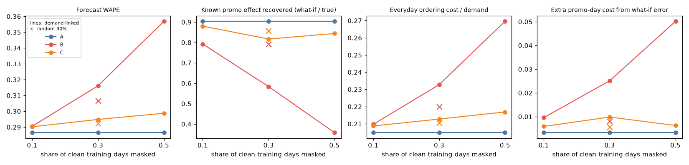

# BlindSpot: Auditing Demand-Forecast Explanations under Stockout Censoring

*Phase 1 write-up: study design, results and limitations.*

## Summary

When a product sells out, the recorded sales understate demand. Models trained on such data are known to
forecast too low. This study asks a different question: **what does censoring do to the explanations of those
forecasts, and to the decisions people make with them?**

We trained the same LightGBM model on three versions of the same data: clean sales (A), sales censored by
simulated stockouts (B), and the same amount of distortion with a random sign (C). With true demand known, we
compared forecasts, SHAP and what-if explanations, and newsvendor ordering outcomes.

Censoring made the model learn a promotion effect about **40% too small**, while forecast error (WAPE) rose only
about **10%**. SHAP still described the censored model faithfully and still ranked the promotion feature 2nd,
so the explanation *looked* as trustworthy as the clean one while its size was wrong. Orders based on the
censored model cost about **12% more** day to day, and ordering for a promotion on its what-if added a further
**11%**. Matched random noise caused much smaller changes. All findings held across 4 masking seeds. They also held
under two falsification checks: masking days at random rather than on high-demand days, and varying the amount of
censoring, where the damage grew steadily with it. A 2020–2026 literature search found no prior study of this
question.

## 1. Research questions

**RQ1.** Does stockout censoring reduce the faithfulness and stability of SHAP explanations and what-if estimates
more than random noise of the same size does?

**RQ2.** Does forecast accuracy reveal how badly the explanations and the decisions built on them are distorted?

**RQ3.** What does acting on explanations from a censored model cost in inventory outcomes?

*Note on RQ2.* It was first phrased as "do explanations change even when accuracy looks similar?". Accuracy did
not stay similar (WAPE rose about 10%), so the question was sharpened after the results to what it was meant to
test: whether the accuracy metric gives a fair warning of the size of the distortion. The data and analysis are
unchanged.

**The gap.** Censored-demand studies measure forecast error and inventory outcomes, not the explanations.
Explanation studies test faithfulness on clean data, and robustness studies use random label noise in
classification. None test a one-sided, systematic distortion like censoring in demand forecasting, against a
matched-noise control, with true demand known.

### Related work (2020–2026)

A literature search covering 2020–2026 was run after the main results, to check that the gap is still open.

| Strand | Examples | Explanations under censoring? |
|---|---|---|
| Censored-demand forecasting | Tobit Kalman filter under lost-sales policies (Trapero, Holgado de Frutos and Pedregal, *IJF* 2024); Tobit exponential smoothing with time aggregation (arXiv 2409.05412, 2024); FreshRetailNet-50K two-stage recovery (Wang et al., 2025) | No: forecast accuracy and inventory only |
| Same dataset, gradient boosting + newsvendor | Azar, *Inventions* 2026: leakage-free LightGBM/XGBoost/CatBoost pipeline with newsvendor policies on FreshRetailNet-50K | No explanation layer (checked from the public code repository; the paper itself could not be accessed). Its profit figures are proxies, because evaluation demand is censored |
| Decisions under censoring | Feature-based newsvendor under censored demand (van der Haar et al., arXiv 2610.17465, 2026); value of censored data (Kumar and Mouchtaki, arXiv 2602.16842, 2026) | No: decisions only |
| Explainable demand forecasting | SHAP for sales and operations planning forecasts (Arboleda-Florez and Castro-Zuluaga, *Production* 2023); MCDFN (arXiv 2405.15598, 2024); explainability for trust in demand planning (Zhu et al., 2025) | No: explanations on the data as recorded |
| Explanation robustness | Interpretation drift under label noise (Raikovskaia, Rakhimzhanov and Pianykh, *Scientific Reports* 2026); explanation multiplicity in SHAP (Hwang et al., NeurIPS 2026); SHAP stability under adversarial attacks (Rajhans and Khawarey, arXiv 2607.01679, 2026) | Related, but random noise or attacks, classification, no decision costs |

**Closest work.** Raikovskaia et al. (2026) report that explanations can drift under label noise while accuracy
stays stable. That supports the premise of RQ2, but their study uses:
- random label flips;
- rule-based classifiers;
- no decision layer.

This study adds, in demand regression:
- one-sided, systematic censoring compared against a matched-noise control;
- SHAP and what-if explanations;
- a known ground truth;
- the cost of the decisions built on the explanations.

**Conclusion.** No published work was found that tests whether stockout censoring changes SHAP or what-if
explanations and the inventory decisions built on them. The gap appears open. This rests on web searches, and
several papers were read at abstract or repository level only, so absence of evidence is not proof.

## 2. Data

- **FreshRetailNet-50K** (CC BY 4.0): 50,000 store-product series of fresh-retail sales, 90 training days
  (2024-03-28 to 06-25) and a 7-day test week (06-26 to 07-02), with hourly sales and hourly stockout flags.
- 44.3% of daily rows have at least one stockout hour. Most stockouts last until closing.
- Discounts outside (0, 1] (0.36% of rows) were set to 1.0 (no discount) and flagged.
- Eligible series: at least 30 stockout-free training days, at least one stockout-free test day, mean sales
  above 0 (45,932 of 50,000). Study sample: **5,000 series**, stratified by top category and sales level.
- Units are normalised by the dataset, so costs are reported per unit of demand.

## 3. Method

### 3.1 Three training conditions

| Condition | Training sales |
|---|---|
| **A, clean** | Recorded sales on stockout-free days |
| **B, censored** | On 30% of stockout-free training days, a stockout is simulated: only sales before a start hour are kept |
| **C, matched noise** | The same days and the same absolute distortion as B, with a random sign |

- **Effective censoring rate:** 30% of stockout-free training days are masked. On 15.9% of those days nothing
  was sold after the simulated stockout hour, so they lose nothing. The share of days whose sales are actually
  reduced is therefore **25.2%**. Masking rates quoted below are nominal; Step 14 reports both.

- **Which days are censored** is demand-linked, as with real stockouts: masked days had 1.27× their series'
  average sales, against 0.88× for other clean days.
- **Simulated start hours** are drawn from the real distribution of stockout start hours.
- **Size of the distortion:** on masked days, B's sales are 46% below the truth; C's are unbiased.
- **Ground truth:** masking only touches stockout-free days, where true demand is known. Real stockout days are
  never used as training targets or for scoring.

### 3.2 Forecasting

- **Target:** next-day sales.
- **Features (22):**
  - recent sales: lags 1, 2, 7, 14, 7- and 14-day rolling means, 7-day rolling standard deviation;
  - calendar: weekday, weekend, holiday;
  - promotion: discount, activity flag;
  - weather: precipitation, temperature, humidity, wind;
  - identity: store, product, city, three category levels.
- No stockout information is used as a feature.
- **Test inputs are identical across conditions** (recorded history), so the three models differ only in what
  they learned.
- **Model:** LightGBM, tuned once on condition A (gbdt against dart, 20 trials each; gbdt chosen), then frozen
  and reused unchanged for B and C.
- **Scoring:** WAPE and bias (WPE) against true demand on stockout-free test days, following the
  frn-50k-baseline protocol.
- **Baselines:** naive, seasonal naive, 7-day moving average, Croston-SBA and the dataset's SSA baseline.

### 3.3 Explanations

- **SHAP:** TreeExplainer on the same 2,000 stockout-free test rows for every model.
  - Importance is compared as shares of the total, because B forecasts lower and so has smaller SHAP values
    everywhere.
  - Stability is the per-row Spearman correlation and top-3 overlap between two models' explanations of the
    same row.
  - **Noise floor:** A retrained with three other model seeds.
- **Faithfulness:**
  - Deletion and insertion curves (SHAP order against random order).
  - An **injected promotion with a known effect**: a synthetic flag on a random 20% of days raises true demand
    by exactly 30%. Conditions A, B and C are rebuilt from this changed truth, and each model's estimate of the
    effect is compared with the known value.
- **What-if:** change only the planned levers (discount within the range seen in training, activity flag). Sales
  history can never be changed.

### 3.4 Inventory decisions

- **Setting:** perishable goods, ordered daily, delivered next day. Unsold units are wasted and unmet demand is
  lost.
- **Costs (relative):** a lost sale costs 1, a wasted unit 0.5, giving a critical ratio of 0.67. Other ratios
  were tested.
- **Order rule** (the same for every model): forecast + safety allowance, where the allowance is the 67th
  percentile of the model's own validation errors, by sales group. Each model measures its errors on its own
  training data, as a real planner would.
- **Promotion decision:** each model orders on its own what-if. This is compared with a planner who applies the
  true +30% effect to the same forecast, so the difference isolates the cost of the what-if error.

### 3.5 Robustness

- The whole experiment was repeated for 4 masking seeds (42–45). Each seed redraws the masked days, the stockout
  hours and C's noise signs.
- Uncertainty is shown with 95% bootstrap intervals that resample stores.

## 4. Results

### 4.1 Forecasts (context)

| Model | WAPE | Bias (WPE) |
|---|---|---|
| LightGBM A | 0.286 | -0.039 |
| LightGBM B | 0.314 | -0.152 |
| LightGBM C | 0.296 | -0.053 |
| Best simple baseline (7-day moving average) | 0.327 | -0.009 |
| SSA baseline, A / B / C | 0.331 / 0.365 / 0.343 | -0.110 / -0.212 / -0.106 |

All three LightGBM models beat every baseline. Censoring pushes forecasts down: B forecasts lower than A on 92%
of test days.

### 4.2 RQ1: explanations under censoring and under noise

| Measure | A | B | C |
|---|---|---|---|
| Per-row SHAP agreement with A (noise floor 0.944) | - | 0.857 | 0.887 |
| Discount importance share, change vs A | - | -21% | +2% |
| Activity-flag importance share, change vs A | - | -40% | -9% |
| Deletion gain over random order | +0.315 | +0.327 | +0.343 |
| Insertion gain over random order | +0.343 | +0.341 | +0.363 |
| Known promotion effect recovered (what-if), all 20,996 clean test days | 90% | 58% | 84% |
| Known promotion effect recovered (what-if), the 4,134 days with the injected promotion | 91% | 59% | 85% |
| Known promotion effect recovered (SHAP), the 4,134 days with the injected promotion | 87% | 55% | 82% |
| Rank of the promotion feature in SHAP | 2nd of 23 | 2nd of 23 | 2nd of 23 |
| Real-lever promo what-if (activity + 20% discount), share of A's uplift | - | 61% | 98% |

The two what-if rows use the same model and definition but average over different test days: Step 8 uses only
the days that carry the injected promotion, while Steps 9–11 use every clean test day. The all-days figure is
the one used in the robustness and falsification tables.

**Answer: yes.** Censoring changes explanations more than matched noise does. It does so mainly for the
promotion features, and it shrinks the learned promotion effect by about a third relative to A.

**Two findings sharpen this:**

1. **SHAP stays faithful to the distorted model.** Deletion and insertion scores are about the same for all
   three models, so SHAP reports correctly what B does. The problem is that B learned the wrong thing. SHAP
   cannot flag this, because a faithful explanation of a distorted model looks just like a good one.
2. **The ranking hides the error.** The promotion feature ranks 2nd in every model, so a reader of a SHAP chart
   sees "promotions matter a lot" in all three cases. Only the *size* is wrong, by 40%.

**Where censoring acts.** The importance share of the recent-sales group as a whole is unchanged (A 66%, B 66%),
but weight moves *within* the group from short to long windows. In B, `roll_mean_14` gains 92% and `lag_1` loses
55%. Short windows carry the most recent censored days, while a 14-day average dilutes them. We had expected the
recent-sales group to show the largest shift. It did not shift as a group; the shift is internal to it. The
largest shift as a share of importance is in the promotion features. Masked days are high-demand days, often
promotion days, so B sees promotions that "did not sell as much".

### 4.3 RQ2: does accuracy reveal the distortion?

| Change from A to B | Size |
|---|---|
| Forecast WAPE | +10% |
| Learned promotion effect (known-effect test) | -35% (58% vs 90% recovered) |
| Promotion what-if on real levers | -39% |
| Importance share of activity flag | -40% |
| Extra cost of ordering a promotion on the what-if | about 8× A's |

**Answer: no.** A 10% rise in WAPE gives no sense of a promotion effect that is a third or more too small. Bias
does point the right way (−15% against −4%), so the accuracy metrics hint that something is off, but they badly
understate how much the explanation-based decisions are affected. Someone validating a model by WAPE alone would
accept B and trust its promotion what-if.

### 4.4 RQ3: cost of acting on the explanations

Everyday ordering (stockout-free test days, scored against true demand):

| | A | B | C |
|---|---|---|---|
| Fill rate | 89.6% | 84.4% | 88.2% |
| Days with a stockout | 34.2% | 43.8% | 36.9% |
| Cost per unit of demand | 0.205 | 0.230 (+12%) | 0.213 (+4%) |

- B's gap grows as lost sales become more costly: +9% at a critical ratio of 0.5, +20% at 0.9.
- **Where the extra cost comes from:** giving B a safety allowance measured on true errors (impossible in
  practice) removes about a quarter of its extra cost. The rest comes from its low forecasts.

Ordering for a planned promotion:

| | A | B | C |
|---|---|---|---|
| Fill rate | 87.5% | 79.1% | 85.9% |
| Cost, ordering on the model's what-if | 0.212 | 0.264 | 0.224 |
| Cost, ordering on the true effect | 0.209 | 0.238 | 0.216 |
| Extra cost from the what-if error | +2% | **+11%** | +4% |
| Units under-ordered per 100 units of demand | 1.2 | 6.2 | 2.5 |

**Answer:** acting on the censored model costs measurably more, both through its everyday forecasts and through
its promotion what-if. Noise of the same size costs about a third as much (+4% against +12% everyday, +4% against +11% on
promotions).

### 4.5 Robustness across masking seeds

| Measure | A | B mean (range) | C mean (range) | B worse than A | B worse than C |
|---|---|---|---|---|---|
| WAPE | 0.286 | 0.316 (0.314–0.318) | 0.294 (0.293–0.296) | 4/4 | 4/4 |
| Per-row SHAP agreement with A | - | 0.857 (0.851–0.861) | 0.888 (0.881–0.893) | - | 4/4 |
| Known promotion effect recovered | 90% | 59% (58–62%) | 85% (79–88%) | 4/4 | 4/4 |
| Everyday cost per unit of demand | 0.205 | 0.233 (0.230–0.235) | 0.212 (0.211–0.213) | 4/4 | 4/4 |
| Extra promotion cost from what-if error | +0.003 | +0.024 (+0.021–0.026) | +0.007 (+0.004–0.012) | 4/4 | 4/4 |

- B is worse than A on all 7 directly comparable metrics in every seed.
- B is worse than C on 11 of 12 metrics in every seed.
- The exception is the importance share of the recent-sales group, which barely moves in B (see 4.2).

### 4.6 Falsification checks: can the finding be explained away?

Two ways the main finding could be an artefact of the setup were tested (Step 14, masking seeds 42 and 43):

1. **Censoring falls mostly on high-demand days.** If the effect came only from *which* days were masked, it
   should vanish when days are masked at random.
2. **No link between amount and damage.** If censoring is the cause, more censoring should do more damage.

| Change from A | B random 30% | B 10% | B 30% (main) | B 50% | C 10% | C 30% | C 50% |
|---|---|---|---|---|---|---|---|
| WAPE | +0.020 | +0.004 | +0.030 | +0.070 | +0.004 | +0.008 | +0.012 |
| Known promotion effect recovered (A: 90%) | 79% | 79% | 58% | 36% | 88% | 82% | 84% |
| Per-row SHAP agreement with A | 0.880 | 0.931 | 0.858 | 0.758 | 0.937 | 0.888 | 0.844 |
| Everyday ordering cost (A: 0.205) | 0.220 | 0.210 | 0.233 | 0.270 | 0.209 | 0.213 | 0.217 |
| Extra promotion cost from what-if error (A: +0.003) | +0.008 | +0.010 | +0.025 | +0.050 | +0.006 | +0.010 | +0.006 |

(10%, 30% and 50% are nominal demand-linked masking rates; the shares of training days whose sales are
actually reduced are 8.4%, 25.2% and 42.2%, and 23.7% for random 30%. C at random 30% recovers 86%.)

- **Random masking: the finding holds.** With masking unrelated to demand, B is still worse than matched noise on
  all 8 metrics checked, in both seeds.
  - The promotion effect is still under-estimated (79% recovered against 86% for noise), but less than with
    demand-linked masking (58%).
  - So part of the damage comes from censoring itself, and part from censoring falling on high-demand days, which
    are often promotion days, as real stockouts do.
- **Dose-response: the finding holds.** B's damage grows steadily from 10% to 30% to 50% censoring on every
  metric. Noise barely changes.
  - At 50% censoring, B recovers only 36% of the promotion effect and costs 32% more to order with.
- **RQ2 is even clearer at low censoring.** At 10%, B and C have *identical* WAPE (both +0.004), yet B
  under-estimates the promotion effect by 11 points and C by 2. Accuracy reveals nothing, while the explanation
  is already off.

## 5. Discussion

The main risk censoring creates for explainable forecasting is not an unfaithful explanation. It is a faithful
explanation of a model that has learned a distorted effect. The usual checks miss this:
- accuracy moves only modestly;
- SHAP faithfulness tests pass;
- feature rankings are unchanged.

The distortion shows up in the *size* of the effects a planner would act on, and so in the cost of their
decisions. Because a matched-noise control is affected much less, the problem comes from the one-sided direction
of censoring, not from the amount of distortion.

**Practical implications:**
- Check effect sizes (what-if uplifts), not just feature rankings, before acting on an explanation.
- Treat strong negative bias as a warning about promotion estimates, not only about forecast level.
- Track how much of a product's history is stockout-affected when judging how far to trust its explanation.

## 6. Limitations

- **Simulated censoring.** Masking is simulated on stockout-free days. It follows real stockout timing and is
  demand-linked, but real censoring may differ in pattern and intensity.
- **A is not perfectly clean.** Real stockout days are never training targets, but their recorded (censored)
  sales still feed the lag features in every condition, including A.
- **Short test week.** Seven days, with a median of 4 stockout-free days per series, and possible seasonal
  shift from the training period.
- **Sample.** 5,000 of 45,932 eligible series; it matches the pool on the measured characteristics.
- **One model, one explainer, one dataset.** LightGBM with TreeSHAP on one fresh-retail dataset. Results may
  differ for other models, explainers or categories.
- **Assumed costs and lead time.** The dataset has no prices, costs or lead times; conclusions held across the
  critical ratios tested (0.5–0.9).
- **Injected promotion.** It is a clean, additive +30% effect independent of other features; real promotion
  effects interact with price, season and product.
- **Descriptive, not causal.** SHAP and what-if describe the models, not customer behaviour.
- **Research question.** RQ2 was sharpened after the results, as noted in Section 1.
- **Falsification scope.** The random-masking and dose-response checks used 2 masking seeds each, on the same
  sample and model.

## 7. Future work (Phase 2)

- **Fix, not just measure:** censoring-aware demand recovery (for example Tobit-style models or two-stage
  recovery) and a test of whether it restores the explanation and the what-if.
- **A warning layer:** an API or interactive explanation that flags forecasts whose explanations may be
  distorted (for example, products with much stockout-affected history) and reports effect sizes with
  uncertainty.
- **Wider scope:** other models (for example CatBoost, XGBoost, neural forecasters), other explainers, longer
  test periods and other datasets.

## 8. Reproducibility

- **Code:** `src/blindspot/`, one script per step in `scripts/`, tests in `tests/`.
- **Re-running everything:** `scripts/step11_experiment.py` re-runs Steps 3–10 and the multi-seed experiment in
  one command, and checks that its seed-42 numbers match the individual steps.
- **Self-checks:** every script ends with explicit checks (`ALL CHECKS PASSED`).
- **Seeds and settings:**
  - masking seed 42, plus 43–45 for robustness;
  - model seed 42, plus 43–45 for the SHAP noise floor;
  - promotion-injection seed 7;
  - frozen model settings in `outputs/models/lgb_config.json`.
- **Prototype:** `app/streamlit_app.py` shows any series' forecasts, explanations, what-if and orders under the
  three conditions.
