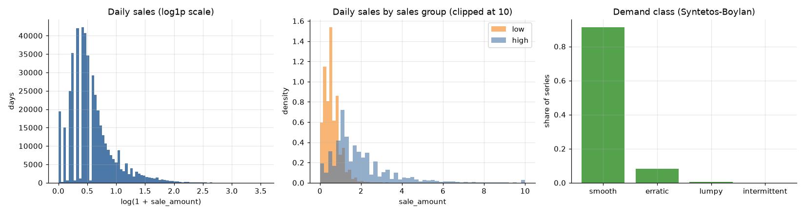
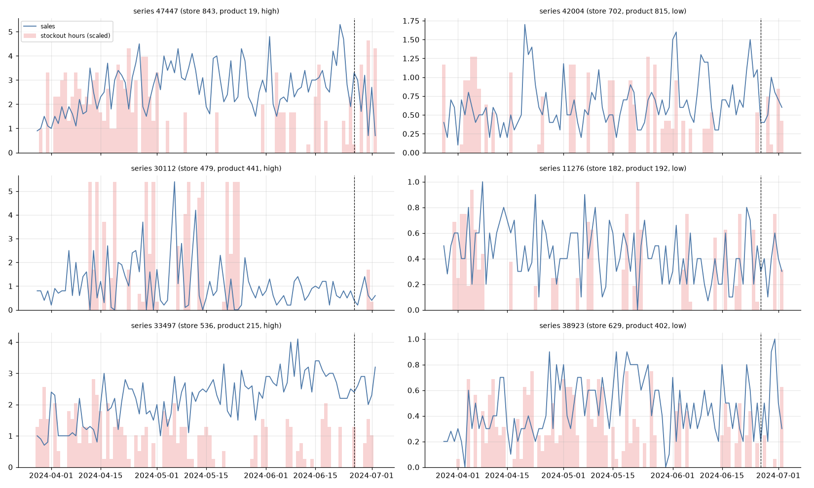
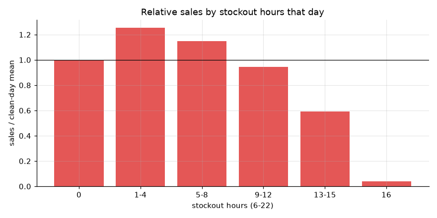
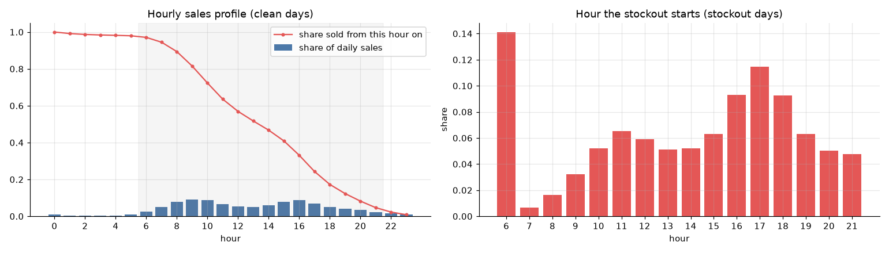
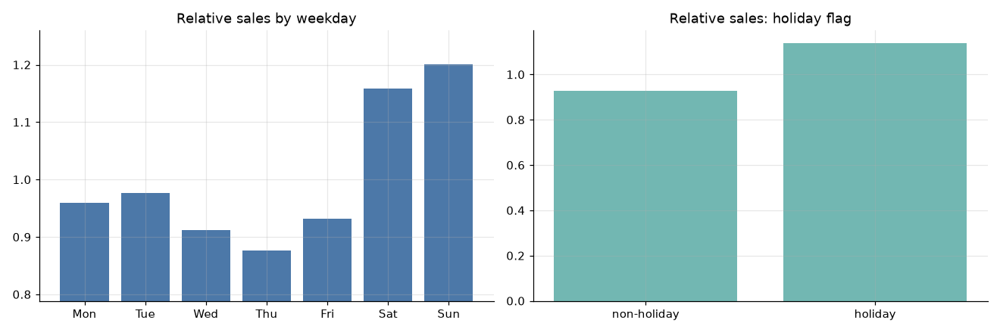
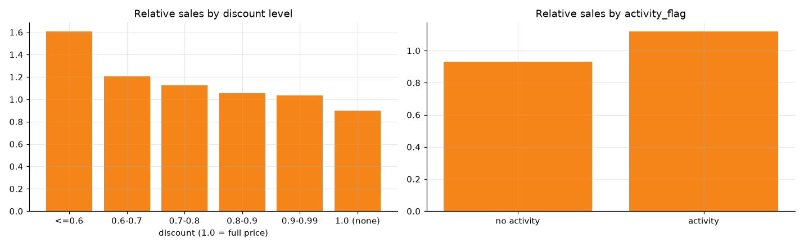
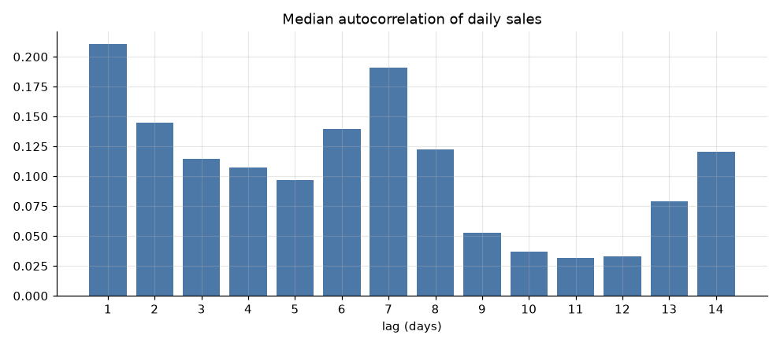
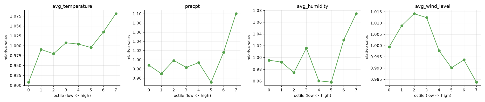
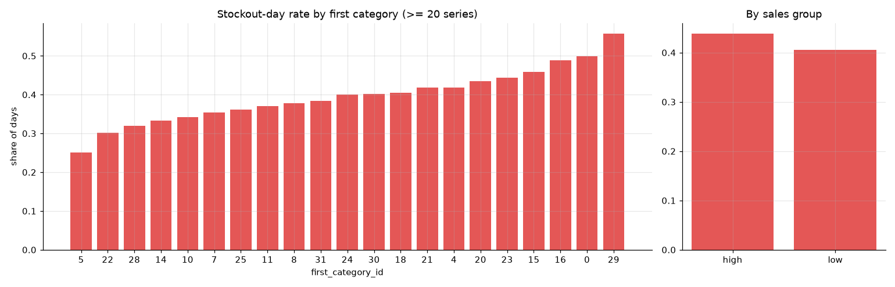
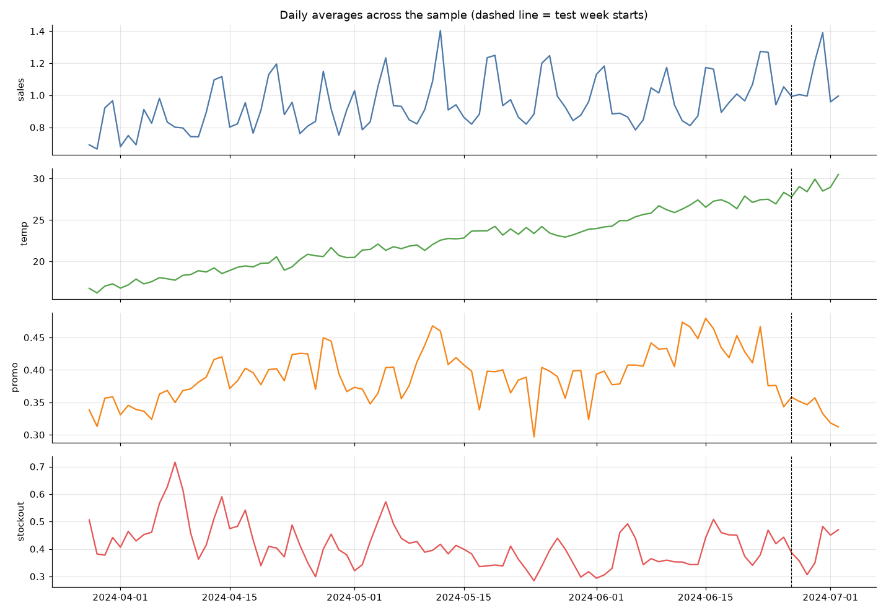

# Step 2.5 EDA summary (study sample: 5,000 series, train days unless stated)

## 1. Sales distribution and intermittency
- Zero-sale days: 4.3% of all train days; 1.8% of clean days
- Daily sales quantiles (50/90/99%): [0.7, 1.9, 5.3]
- Syntetos-Boylan demand class (clean days): smooth 91.4%, erratic 8.2%, lumpy 0.4%, intermittent 0.1%

- Implication: demand is mostly smooth/erratic at the daily level, not truly intermittent; Croston-SBA is kept as a baseline but is not expected to win.

## 2. Example series with stockout days

- Red bars = stockout hours that day (taller = longer stockout); dashed line = start of test week.

## 3. How much do stockouts hide?
- stockout hours 0: sales = 1.00 x the series' clean-day mean
- stockout hours 1-4: sales = 1.26 x the series' clean-day mean
- stockout hours 5-8: sales = 1.15 x the series' clean-day mean
- stockout hours 9-12: sales = 0.95 x the series' clean-day mean
- stockout hours 13-15: sales = 0.59 x the series' clean-day mean
- stockout hours 16: sales = 0.04 x the series' clean-day mean

- Note: this mixes lost sales with selection (items that sell out may have had high demand). It shows observed sales are depressed, not the true size of hidden demand.

## 4. Hourly sales profile and stockout start hour
- Peak sales hours (clean days): 9:00, 16:00, 10:00
- If a stockout starts at the observed start-hour mix and lasts the rest of the day, the expected hidden share of daily sales is about 46%. This is the scale of censoring Step 3 will impose.

## 5. Weekday and holiday effects (clean days)
- Relative sales by weekday: Mon 0.96, Tue 0.98, Wed 0.91, Thu 0.88, Fri 0.93, Sat 1.16, Sun 1.20
- Holiday 1.14 vs non-holiday 0.93

- Note: holiday_flag is 1 on 34% of days, so it likely includes weekends; compare with the weekday chart.

## 6. Promotion effect (the what-if levers, clean days)
- discount <=0.6: relative sales 1.61 (5,301 days)
- discount 0.6-0.7: relative sales 1.21 (12,794 days)
- discount 0.7-0.8: relative sales 1.13 (25,687 days)
- discount 0.8-0.9: relative sales 1.05 (49,052 days)
- discount 0.9-0.99: relative sales 1.03 (37,926 days)
- discount 1.0 (none): relative sales 0.90 (132,913 days)
- activity_flag 1 vs 0: 1.12 vs 0.93 (uplift +21%)
- Within the same series (series with both promo and non-promo clean days, n=3,943): median uplift +35%

- Caveat: discounts are not randomly assigned, so these are associations, not causal uplifts.

## 7. Autocorrelation of daily sales (lags 1-14)
- Median per-series autocorrelation: lag1 0.21, lag2 0.14, lag3 0.11, lag4 0.11, lag5 0.10, lag6 0.14, lag7 0.19, lag8 0.12, lag9 0.05, lag10 0.04, lag11 0.03, lag12 0.03, lag13 0.08, lag14 0.12

- Supports lags 1, 2, 7 and 7/14-day rolling means if lag 1 and lag 7 stand out.

## 8. Weather vs sales (clean days)
- avg_temperature: relative sales from 0.91 (lowest octile) to 1.08 (highest); range 0.17
- precpt: relative sales from 0.99 (lowest octile) to 1.10 (highest); range 0.15
- avg_humidity: relative sales from 1.00 (lowest octile) to 1.07 (highest); range 0.12
- avg_wind_level: relative sales from 1.00 (lowest octile) to 0.98 (highest); range 0.03

## 9. Stockout rate by category and sales group
- Stockout-day rate: low-sales 40.6%, high-sales 43.8%
- Across categories with >= 20 series: 25.1% to 55.7%

## 10. Train vs test week (descriptive only, not used for any modelling choice)
- sales: last train week 1.082 vs test week 1.078
- temp: last train week 27.370 vs test week 29.016
- promo: last train week 0.408 vs test week 0.339
- stockout: last train week 0.410 vs test week 0.400

