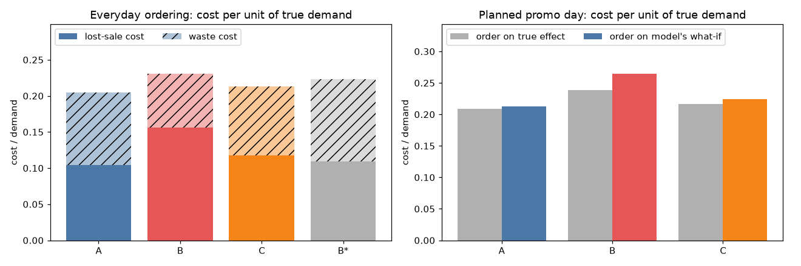
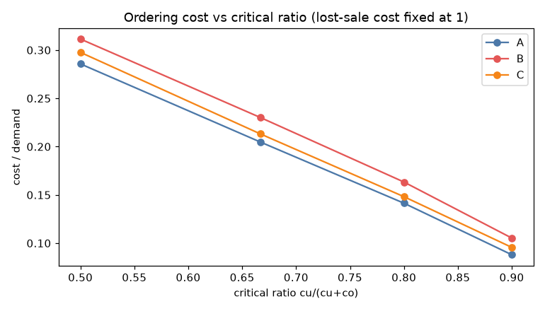

# Step 10 report: inventory simulation

Assumptions (no prices, costs or lead times in the data): perishable products ordered daily for next-day delivery; unsold units are wasted, unmet demand is lost; costs are relative. Sales units are normalised, so costs are reported per unit of true demand. Same ordering rule for every model.

## Part 1: everyday ordering (critical ratio 0.67: lost sale = 1, wasted unit = 0.5)

20,996 clean test days scored against true demand. Safety = 67% quantile of each model's validation errors (actual - forecast) against its own training target, per sales group.

| model | safety low | safety high | mean forecast / demand | fill rate | stockout days | short / demand | waste / demand | cost / demand | cost vs A (95% CI) |
|---|---|---|---|---|---|---|---|---|---|
| A | +0.110 | +0.294 | 0.961 | 89.6% | 34.2% | 0.104 | 0.202 | 0.205 | - |
| B | +0.105 | +0.341 | 0.847 | 84.4% | 43.8% | 0.156 | 0.148 | 0.230 | +12.4% (diff +0.022 to +0.029) |
| C | +0.091 | +0.304 | 0.947 | 88.2% | 36.9% | 0.118 | 0.191 | 0.213 | +4.1% (diff +0.007 to +0.011) |
| B* | +0.211 | +0.597 | 0.847 | 89.0% | 30.0% | 0.110 | 0.227 | 0.223 | +9.0% (diff +0.016 to +0.022) |

B* = model B, but its safety allowance is calibrated on TRUE validation errors (impossible in practice; diagnostic only). It separates the cost of B's low forecasts from the cost of B's mis-calibrated safety stock.

- B's validation errors: on masked days B's own target is censored, so the error looks -0.191 on average instead of the true +0.394; its planner therefore under-sizes the safety allowance.

By sales group:

| group | cost/demand A | B | C | fill rate A | B | C |
|---|---|---|---|---|---|---|
| low | 0.248 | 0.264 | 0.253 | 88.2% | 83.2% | 86.6% |
| high | 0.168 | 0.201 | 0.180 | 90.9% | 85.4% | 89.6% |

Sensitivity: cost / demand at other critical ratios (shortage cost fixed at 1, waste cost varied):

| critical ratio | waste cost | A | B | C | B vs A |
|---|---|---|---|---|---|
| 0.50 | 1.000 | 0.286 | 0.311 | 0.298 | +9.0% |
| 0.67 | 0.500 | 0.205 | 0.230 | 0.213 | +12.4% |
| 0.80 | 0.250 | 0.141 | 0.163 | 0.148 | +15.5% |
| 0.90 | 0.111 | 0.088 | 0.105 | 0.096 | +19.6% |

- [PASS] B's ordering costs significantly more than A's (CI above 0)
- [PASS] B fills less of the true demand than A
- [PASS] B costs more than A at every critical ratio tested
- B's WAPE was +10% worse than A's (Step 6); its ordering cost is +12% higher. C (same-size noise) costs +4%.

## Part 2: ordering for a planned promo (injected promo, known effect)

A promo is planned for each of the 20,996 clean test days; true demand = demand without promo x 1.30. Each model orders: (its promo-off forecast + its what-if uplift) + safety. The reference planner knows the TRUE effect (+30%) and orders the same promo-off forecast x 1.30 + the same safety, so any difference comes only from the what-if error (not from knowing the day's actual demand). Safety allowances are those from Part 1 (same condition, same rule).

| model | estimated / true uplift | order on what-if: fill rate | cost / demand | order on true effect: cost / demand | extra cost from what-if error (95% CI) | units under-ordered per 100 demand |
|---|---|---|---|---|---|---|
| A | 90% | 87.5% | 0.212 | 0.209 | +0.003 (+0.002 to +0.005) | 1.2 |
| B | 58% | 79.1% | 0.264 | 0.238 | +0.026 (+0.022 to +0.029) | 6.2 |
| C | 84% | 85.9% | 0.224 | 0.216 | +0.008 (+0.006 to +0.010) | 2.5 |

- [PASS] ordering on B's what-if costs significantly more than ordering on the true effect
- [PASS] B's what-if error costs more than A's
- Ordering on B's what-if adds +11% to the cost of a promo day versus knowing the true effect; for A the figure is +2%, for C +4%.

## Summary

ALL CHECKS PASSED

Done in 11s.