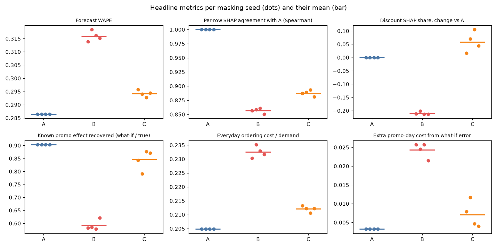

# Step 11 report: experiment runner

## 1. Pipeline (Steps 3-10)

| step | status | time | log |
|---|---|---|---|
| step3_build_conditions | OK | 12s | logs/step3_build_conditions.log |
| step4_build_features | OK | 29s | logs/step4_build_features.log |
| step5_baselines | OK | 13s | logs/step5_baselines.log |
| step6b_train | OK | 16s | logs/step6b_train.log |
| step7_shap | OK | 26s | logs/step7_shap.log |
| step8_faithfulness | OK | 51s | logs/step8_faithfulness.log |
| step9_whatif | OK | 43s | logs/step9_whatif.log |
| step10_inventory | OK | 14s | logs/step10_inventory.log |

- [PASS] all 8 pipeline steps ran and reported no failed checks
## 2. Multi-seed experiment

Ran 4 seeds with the frozen Step 6 configuration, 2,000 explained rows, promo scenario 'activity + 20% discount', injected +30% promo on 20% of days, newsvendor costs 1 / 0.5.

- [PASS] seed 42 WAPE A = Step 6 (0.2865)
- [PASS] seed 42 WAPE B = Step 6 (0.3139)
- [PASS] seed 42 WAPE C = Step 6 (0.2957)
- [PASS] seed 42 per-row SHAP agreement A vs B = Step 7 (0.857)
- [PASS] seed 42 per-row SHAP agreement A vs C = Step 7 (0.887)
- [PASS] seed 42 ordering cost, injected recovery and promo extra cost for A = Steps 9-10
- [PASS] seed 42 ordering cost, injected recovery and promo extra cost for B = Steps 9-10
- [PASS] seed 42 ordering cost, injected recovery and promo extra cost for C = Steps 9-10

## 3. Main results (masking seed 42)

| metric | A (clean) | B (censored) | C (matched noise) |
|---|---|---|---|
| Forecast WAPE | 0.286 | 0.314 | 0.296 |
| Forecast bias (WPE) | -0.039 | -0.152 | -0.053 |
| Per-row SHAP agreement with A (Spearman) | reference | 0.857 | 0.887 |
| Discount SHAP share, change vs A | reference | -21.1% | +1.7% |
| Activity-flag SHAP share, change vs A | reference | -40.3% | -9.4% |
| Recent-sales SHAP share, change vs A | reference | +0.8% | -6.4% |
| Real-lever promo what-if, share of A's uplift | reference | 61% | 98% |
| Known promo effect recovered (what-if / true) | 90% | 58% | 84% |
| Everyday ordering cost / demand | 0.205 | 0.230 | 0.213 |
| Everyday fill rate | 89.6% | 84.4% | 88.2% |
| Everyday stockout days | 34.2% | 43.8% | 36.9% |
| Extra promo-day cost from what-if error | +0.003 | +0.026 | +0.008 |

Noise floor for SHAP agreement (Step 7): retraining A with another model seed gives per-row agreement 0.944.

## 4. Robustness across 4 masking seeds (42, 43, 44, 45)

Each seed redraws which training days are masked, the simulated stockout hours, and C's noise signs. Condition A does not depend on the masking seed. 'Worse' follows each metric's direction (higher WAPE/cost, larger |bias| or |share change|, lower agreement/fill rate, further from 100% recovery).

| metric | A | B mean (min to max) | C mean (min to max) | B worse than A | B worse than C |
|---|---|---|---|---|---|
| Forecast WAPE | 0.286 | 0.316 (0.314 to 0.318) | 0.294 (0.293 to 0.296) | 4/4 | 4/4 |
| Forecast bias (WPE) | -0.039 | -0.156 (-0.160 to -0.152) | -0.051 (-0.053 to -0.046) | 4/4 | 4/4 |
| Per-row SHAP agreement with A (Spearman) | reference | 0.857 (0.851 to 0.861) | 0.888 (0.881 to 0.893) | n/a | 4/4 |
| Discount SHAP share, change vs A | reference | -20.9% (-21.3% to -20.2%) | +5.9% (+1.7% to +10.5%) | n/a | 4/4 |
| Activity-flag SHAP share, change vs A | reference | -36.0% (-42.6% to -29.2%) | -9.0% (-18.1% to +1.4%) | n/a | 4/4 |
| Recent-sales SHAP share, change vs A | reference | +0.5% (-0.1% to +0.8%) | -6.8% (-7.6% to -6.4%) | n/a | 0/4 |
| Real-lever promo what-if, share of A's uplift | reference | 63% (61% to 64%) | 101% (98% to 107%) | n/a | 4/4 |
| Known promo effect recovered (what-if / true) | 90% | 59% (58% to 62%) | 85% (79% to 88%) | 4/4 | 4/4 |
| Everyday ordering cost / demand | 0.205 | 0.233 (0.230 to 0.235) | 0.212 (0.211 to 0.213) | 4/4 | 4/4 |
| Everyday fill rate | 89.6% | 84.1% (83.7% to 84.4%) | 88.5% (88.2% to 88.8%) | 4/4 | 4/4 |
| Everyday stockout days | 34.2% | 43.8% (43.5% to 44.2%) | 36.3% (35.7% to 36.9%) | 4/4 | 4/4 |
| Extra promo-day cost from what-if error | +0.003 | +0.024 (+0.021 to +0.026) | +0.007 (+0.004 to +0.012) | 4/4 | 4/4 |

- B is worse than A in every seed on 7 of 7 absolute metrics.
- B is worse than C (matched noise) in every seed on 11 of 12 metrics; not in every seed: recent_sales_share_change.

## Summary

ALL CHECKS PASSED

Done in 429s.