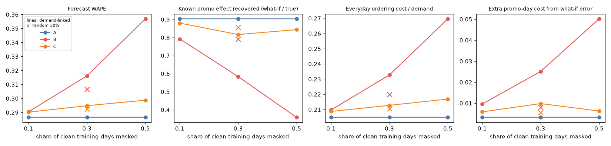

# Step 14 report: falsification checks

Can the main finding (censoring hurts more than matched noise) be explained away by the setup?

## Settings

| setting | target mask rate | masking | share of clean training days masked (seed 42) | share actually censored (sales lost) |
|---|---|---|---|---|
| random 30% | 30% | random | 30.0% | 23.7% |
| demand-linked 10% | 10% | demand-linked | 10.0% | 8.4% |
| demand-linked 30% (main) | 30% | demand-linked | 30.0% | 25.2% |
| demand-linked 50% | 50% | demand-linked | 50.1% | 42.2% |

A masked day whose simulated stockout starts after its last sale loses nothing, so the share actually censored is below the masked share.

- [PASS] random 30%: realised mask share within 3 points of target
- [PASS] demand-linked 10%: realised mask share within 3 points of target
- [PASS] demand-linked 30% (main): realised mask share within 3 points of target
- [PASS] demand-linked 50%: realised mask share within 3 points of target
- [PASS] condition A is identical in every setting and seed

## Results (mean over seeds 42, 43)

| metric | A | B: random 30% | B: demand-linked 10% | B: demand-linked 30% (main) | B: demand-linked 50% | C: random 30% | C: demand-linked 10% | C: demand-linked 30% (main) | C: demand-linked 50% |
|---|---|---|---|---|---|---|---|---|---|
| Forecast WAPE | 0.286 | 0.306 | 0.290 | 0.316 | 0.357 | 0.292 | 0.290 | 0.295 | 0.299 |
| Forecast bias (WPE) | -0.039 | -0.134 | -0.075 | -0.156 | -0.241 | -0.054 | -0.053 | -0.053 | -0.058 |
| Per-row SHAP agreement with A (Spearman) | - | 0.880 | 0.931 | 0.858 | 0.758 | 0.915 | 0.937 | 0.888 | 0.844 |
| Discount SHAP share, change vs A | - | -5.6% | -6.9% | -20.6% | -42.3% | +3.1% | +3.3% | +4.3% | +2.8% |
| Activity-flag SHAP share, change vs A | - | -16.1% | -13.2% | -41.4% | -62.1% | -1.1% | -2.4% | -9.7% | -2.3% |
| Known promo effect recovered (what-if / true) | 90% | 79% | 79% | 58% | 36% | 86% | 88% | 82% | 84% |
| Everyday ordering cost / demand | 0.205 | 0.220 | 0.210 | 0.233 | 0.270 | 0.211 | 0.209 | 0.213 | 0.217 |
| Extra promo-day cost from what-if error | +0.003 | +0.008 | +0.010 | +0.025 | +0.050 | +0.006 | +0.006 | +0.010 | +0.006 |

## 1. Random masking: is censoring itself the cause?

| metric | B worse than C (seeds) |
|---|---|
| Forecast WAPE | 2/2 |
| Forecast bias (WPE) | 2/2 |
| Per-row SHAP agreement with A (Spearman) | 2/2 |
| Discount SHAP share, change vs A | 2/2 |
| Activity-flag SHAP share, change vs A | 2/2 |
| Known promo effect recovered (what-if / true) | 2/2 |
| Everyday ordering cost / demand | 2/2 |
| Extra promo-day cost from what-if error | 2/2 |

- **HOLDS**: with masking unrelated to demand, censoring is still worse than matched noise on forecast error, explanation agreement, promotion-effect recovery and ordering costs in every seed
- B's promotion-effect recovery: 79% with random masking vs 58% with demand-linked masking (A: 90%). Part of the damage comes from censoring as such, part from censoring falling on high-demand (often promotion) days.

## 2. Dose-response: does more censoring do more damage?

| metric | B - A at 10% | at 30% | at 50% | C - A at 10% | at 30% | at 50% | B gap grows with rate |
|---|---|---|---|---|---|---|---|
| Forecast WAPE | +0.004 | +0.030 | +0.070 | +0.004 | +0.008 | +0.012 | yes |
| Forecast bias (WPE) | -0.036 | -0.117 | -0.203 | -0.014 | -0.014 | -0.019 | yes |
| Known promo effect recovered (what-if / true) | -11% | -32% | -55% | -2% | -9% | -6% | yes |
| Everyday ordering cost / demand | +0.005 | +0.028 | +0.065 | +0.004 | +0.008 | +0.012 | yes |
| Extra promo-day cost from what-if error | +0.006 | +0.022 | +0.047 | +0.003 | +0.007 | +0.003 | yes |

- **HOLDS**: the damage from censoring grows steadily with the amount of censoring on every metric shown
- **HOLDS**: at every censoring rate, B's promotion-effect error is larger than C's

## Summary

ALL CHECKS PASSED

Done in 323s.