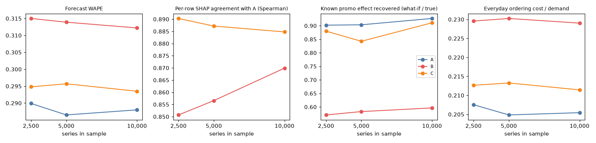

# Step 15 report: sample-size check

Does the main finding depend on the 5,000-series sample? Same experiment (30% demand-linked masking), same frozen model configuration, nested stratified samples.

## Samples

| sample | series | rows | share low-sales | categories | mean stockout rate (train) | mean promo rate (train) |
|---|---|---|---|---|---|---|
| eligible pool | 45,932 | - | 74.5% | 32 | 41.3% | 39.1% |
| 2,500 | 2,500 | 242,500 | 74.5% | 28 | 41.4% | 40.0% |
| 5,000 | 5,000 | 485,000 | 74.5% | 29 | 41.4% | 39.4% |
| 10,000 | 10,000 | 970,000 | 74.5% | 29 | 41.4% | 39.3% |

- [PASS] 2,500: exact size, unique, all eligible
- [PASS] 2,500: low-sales share within 1 point of the eligible pool
- [PASS] 5,000: exact size, unique, all eligible
- [PASS] 5,000: low-sales share within 1 point of the eligible pool
- [PASS] 10,000: exact size, unique, all eligible
- [PASS] 10,000: low-sales share within 1 point of the eligible pool
- [PASS] 2,500 sample is inside the 5,000 sample
- [PASS] 5,000 sample is inside the 10,000 sample
- [PASS] 5,000 sample is the study sample
- [PASS] 2,500: panel has every series with all 97 days
- [PASS] 10,000: panel has every series with all 97 days

## Results (mean over seed 42)

| metric | A: 2,500 | A: 5,000 | A: 10,000 | B: 2,500 | B: 5,000 | B: 10,000 | C: 2,500 | C: 5,000 | C: 10,000 |
|---|---|---|---|---|---|---|---|---|---|
| Forecast WAPE | 0.290 | 0.286 | 0.288 | 0.315 | 0.314 | 0.312 | 0.295 | 0.296 | 0.293 |
| Forecast bias (WPE) | -0.040 | -0.039 | -0.032 | -0.154 | -0.152 | -0.147 | -0.046 | -0.053 | -0.050 |
| Per-row SHAP agreement with A (Spearman) | - | - | - | 0.851 | 0.857 | 0.870 | 0.890 | 0.887 | 0.885 |
| Discount SHAP share, change vs A | - | - | - | -21.3% | -21.1% | -16.8% | +1.7% | +1.7% | +6.6% |
| Activity-flag SHAP share, change vs A | - | - | - | -31.1% | -40.3% | -42.4% | -9.5% | -9.4% | -7.4% |
| Known promo effect recovered (what-if / true) | 90% | 90% | 93% | 57% | 58% | 60% | 88% | 84% | 91% |
| Everyday ordering cost / demand | 0.208 | 0.205 | 0.205 | 0.230 | 0.230 | 0.229 | 0.213 | 0.213 | 0.211 |
| Extra promo-day cost from what-if error | +0.006 | +0.003 | +0.003 | +0.027 | +0.026 | +0.024 | +0.003 | +0.008 | +0.003 |

## Does the finding hold at every size?

| metric | B worse than C: 2,500 | B worse than C: 5,000 | B worse than C: 10,000 | B worse than A: 2,500 | B worse than A: 5,000 | B worse than A: 10,000 |
|---|---|---|---|---|---|---|
| Forecast WAPE | 1/1 | 1/1 | 1/1 | 1/1 | 1/1 | 1/1 |
| Forecast bias (WPE) | 1/1 | 1/1 | 1/1 | 1/1 | 1/1 | 1/1 |
| Per-row SHAP agreement with A (Spearman) | 1/1 | 1/1 | 1/1 | - | - | - |
| Discount SHAP share, change vs A | 1/1 | 1/1 | 1/1 | - | - | - |
| Activity-flag SHAP share, change vs A | 1/1 | 1/1 | 1/1 | - | - | - |
| Known promo effect recovered (what-if / true) | 1/1 | 1/1 | 1/1 | 1/1 | 1/1 | 1/1 |
| Everyday ordering cost / demand | 1/1 | 1/1 | 1/1 | 1/1 | 1/1 | 1/1 |
| Extra promo-day cost from what-if error | 1/1 | 1/1 | 1/1 | 1/1 | 1/1 | 1/1 |

- **HOLDS**: at every sample size, censoring is worse than matched noise on forecast error, explanation agreement, promotion-effect recovery and ordering costs
- **HOLDS**: at every sample size, censoring is worse than the clean model on the same metrics
- **HOLDS**: B's promotion-effect recovery varies by less than 10 points across sizes (2,500: 57%, 5,000: 58%, 10,000: 60%; A: 90%, 90%, 93%)

## Summary

ALL CHECKS PASSED

Done in 167s.