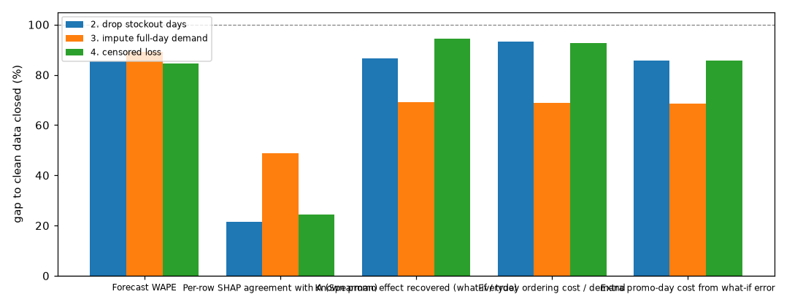

# Step 17 report: alternative approaches to stockout censoring

5,000 series, 30% demand-linked masking, seeds 42, 43. Every approach starts from the censored sales; approaches 2-4 also know which days stocked out and at what hour, but never the true demand.

| approach | what it does |
|---|---|
| 1. naive (= B) | trains on recorded sales as if they were demand |
| 2. drop stockout days | removes stockout days as training targets (they still feed the lag features) |
| 3. impute full-day demand | scales the sales before the stockout up by the series' usual share of the day's sales made by that hour; for very early stockouts, adds the usual rest of the day |
| 4. censored loss | keeps stockout days but treats their sales as a minimum: forecasts below are penalised, forecasts above are not |

Approaches 2-4 set the ordering safety allowance from validation days without a stockout.

## How good is the imputation? (seed 42, 78,998 simulated stockout days)

| sales on stockout days | total vs true demand | WAPE vs true demand |
|---|---|---|
| recorded (censored) | -45.9% | 0.459 |
| imputed | -5.1% | 0.241 |

- [PASS] imputation reduces the demand shortfall
- [PASS] A and naive reproduce Step 11's A and B for the shared seeds

## Results (mean over 2 seeds)

| metric | clean (reference) | 1. naive (= B) | 2. drop stockout days | 3. impute full-day demand | 4. censored loss |
|---|---|---|---|---|---|
| Forecast WAPE | 0.286 | 0.316 | 0.291 | 0.290 | 0.291 |
| Forecast bias (WPE) | -0.039 | -0.156 | -0.028 | -0.057 | -0.004 |
| Per-row SHAP agreement with A (Spearman) | - | 0.858 | 0.888 | 0.927 | 0.892 |
| Discount SHAP share, change vs A | - | -20.6% | +0.5% | -5.5% | -6.9% |
| Activity-flag SHAP share, change vs A | - | -41.4% | -14.0% | -12.0% | -0.6% |
| Known promo effect recovered (what-if / true) | 90% | 58% | 86% | 80% | 89% |
| Everyday ordering cost / demand | 0.205 | 0.233 | 0.207 | 0.214 | 0.207 |
| Everyday fill rate | 89.6% | 84.0% | 89.3% | 86.5% | 89.2% |
| Extra promo-day cost from what-if error | +0.003 | +0.025 | +0.006 | +0.010 | +0.006 |

## Gap to clean data closed (100% = as good as A, 0% = no better than naive, negative = worse)

| metric | 2. drop stockout days | 3. impute full-day demand | 4. censored loss |
|---|---|---|---|
| Forecast WAPE | 85% | 89% | 85% |
| Per-row SHAP agreement with A (Spearman) | 21% | 49% | 24% |
| Known promo effect recovered (what-if / true) | 86% | 69% | 95% |
| Everyday ordering cost / demand | 93% | 69% | 93% |
| Extra promo-day cost from what-if error | 86% | 69% | 86% |
| **average** | **74%** | **69%** | **76%** |

## Better than naive in every seed?

| metric | 2. drop stockout days | 3. impute full-day demand | 4. censored loss |
|---|---|---|---|
| Forecast WAPE | 2/2 | 2/2 | 2/2 |
| Per-row SHAP agreement with A (Spearman) | 2/2 | 2/2 | 2/2 |
| Known promo effect recovered (what-if / true) | 2/2 | 2/2 | 2/2 |
| Everyday ordering cost / demand | 2/2 | 2/2 | 2/2 |
| Extra promo-day cost from what-if error | 2/2 | 2/2 | 2/2 |

- **HOLDS**: 2. drop stockout days is better than naive on every core metric in every seed
- **HOLDS**: 3. impute full-day demand is better than naive on every core metric in every seed
- **HOLDS**: 4. censored loss is better than naive on every core metric in every seed

## Recommendation

**4. censored loss** closes the largest share of the gap to clean data on average (76%). Its promotion-effect recovery is 89% (naive 58%, clean 90%).

## Summary

ALL CHECKS PASSED

Done in 228s.