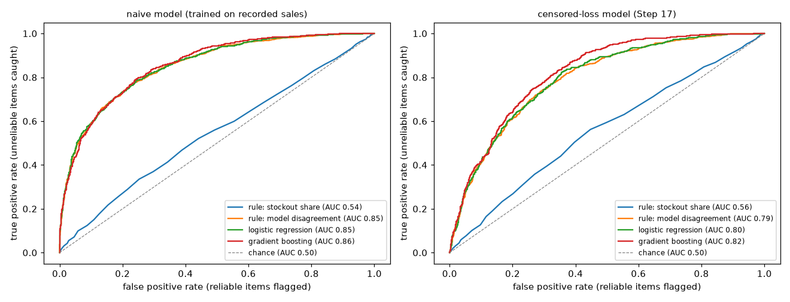
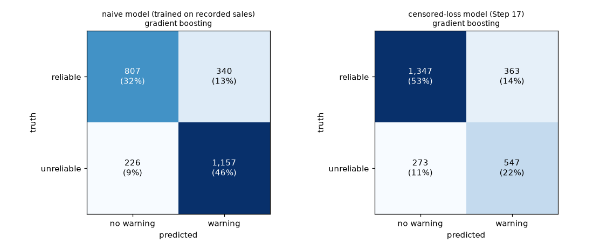

# Step 18 report: reliability warning for explanations

Can a retailer tell which items have a distorted explanation, without knowing the true demand?

- **Unit:** one item (store x product), 5,000 items.
- **Label:** 1 = *unreliable*: the item's explanation (mean per-row SHAP rank agreement with the clean model A over its clean test days) is below the 5% quantile of the same agreement for A retrained with other seeds (43, 44). In words: worse than retraining noise produces for 95% of items.
- **Warning inputs** (no true demand needed): share of training days with a stockout; share of business hours out of stock; share of training days with a promotion; mean discount level; mean recorded daily sales; variability of recorded sales; low-sales item; naive vs censored-loss explanation disagreement; naive vs censored-loss forecast gap.
- **Out of sample:** train on masking seed 42 and half the stores; test on masking seed 43 and the other stores. Thresholds are chosen on the training part (maximum F1).

## Labels

Noise-floor threshold: per-item agreement < **0.881**.

| model | train items | unreliable (train) | test items | unreliable (test) | mean agreement with A (test) |
|---|---|---|---|---|---|
| A retrained (A', reference) | 5,000 | 5.0% | - | - | 0.942 |
| naive model (trained on recorded sales) | 2,470 | 57.9% | 2,530 | 54.7% | 0.860 |
| censored-loss model (Step 17) | 2,470 | 32.8% | 2,530 | 32.4% | 0.893 |

- [PASS] about 5% of A' items fall below the threshold (by construction)
- [PASS] no store is in both the training and the test part
- [PASS] naive: at least 20 unreliable items in each part (enough to evaluate)
- [PASS] censored_loss: at least 20 unreliable items in each part (enough to evaluate)

## Warning for the naive model (trained on recorded sales)

Test items: 2,530, unreliable: 1,383 (54.7%). Always answering "reliable" would score accuracy 54.7%, so accuracy alone is not informative here.

| warning | ROC AUC (95% CI) | PR AUC | accuracy | precision | recall | specificity | F1 |
|---|---|---|---|---|---|---|---|
| rule: stockout share | 0.544 (0.522-0.567) | 0.594 | 54.7% | 54.7% | 100.0% | 0.0% | 0.707 |
| rule: model disagreement | 0.853 (0.838-0.869) | 0.874 | 76.0% | 73.8% | 86.9% | 62.8% | 0.798 |
| logistic regression | 0.854 (0.840-0.869) | 0.875 | 76.3% | 74.7% | 85.5% | 65.1% | 0.798 |
| gradient boosting | 0.858 (0.844-0.872) | 0.875 | 77.6% | 77.3% | 83.7% | 70.4% | 0.803 |

PR AUC of a random warning = prevalence = 0.547; ROC AUC of a random warning = 0.5.

**Confusion matrices** (test items; rows = truth, columns = warning):

| warning | true reliable, no warning (TN) | false alarm (FP) | missed (FN) | caught (TP) |
|---|---|---|---|---|
| rule: stockout share | 0 | 1,147 | 0 | 1,383 |
| rule: model disagreement | 720 | 427 | 181 | 1,202 |
| logistic regression | 747 | 400 | 200 | 1,183 |
| gradient boosting | 807 | 340 | 226 | 1,157 |

rule: stockout share: the best training threshold flags every item (or none), i.e. the score cannot separate the classes at any useful cut-off; judge it by ROC AUC, not by its threshold metrics.

Logistic regression weights (standardised inputs; positive = more likely unreliable):

| input | weight |
|---|---|
| naive vs censored-loss explanation disagreement | +1.88 |
| low-sales item | -0.15 |
| naive vs censored-loss forecast gap | +0.15 |
| share of training days with a stockout | +0.13 |
| mean discount level | -0.13 |
| share of business hours out of stock | -0.10 |
| share of training days with a promotion | -0.06 |
| mean recorded daily sales | -0.04 |
| variability of recorded sales | -0.01 |

- Best warning by ROC AUC: **gradient boosting** (AUC 0.858, CI 0.844-0.872). The CI excludes 0.5: the warning ranks items better than chance.
- At its frozen threshold it flags 1,497 of 2,530 items and catches 1,157 of 1,383 unreliable ones (recall 84%); 77% of its warnings are right.

## Warning for the censored-loss model (Step 17)

Test items: 2,530, unreliable: 820 (32.4%). Always answering "reliable" would score accuracy 67.6%, so accuracy alone is not informative here.

| warning | ROC AUC (95% CI) | PR AUC | accuracy | precision | recall | specificity | F1 |
|---|---|---|---|---|---|---|---|
| rule: stockout share | 0.559 (0.534-0.581) | 0.372 | 32.8% | 32.5% | 99.9% | 0.6% | 0.491 |
| rule: model disagreement | 0.793 (0.775-0.813) | 0.619 | 69.5% | 51.9% | 79.8% | 64.6% | 0.629 |
| logistic regression | 0.796 (0.779-0.816) | 0.622 | 72.1% | 55.2% | 72.6% | 71.8% | 0.627 |
| gradient boosting | 0.819 (0.803-0.837) | 0.644 | 74.9% | 60.1% | 66.7% | 78.8% | 0.632 |

PR AUC of a random warning = prevalence = 0.324; ROC AUC of a random warning = 0.5.

**Confusion matrices** (test items; rows = truth, columns = warning):

| warning | true reliable, no warning (TN) | false alarm (FP) | missed (FN) | caught (TP) |
|---|---|---|---|---|
| rule: stockout share | 10 | 1,700 | 1 | 819 |
| rule: model disagreement | 1,105 | 605 | 166 | 654 |
| logistic regression | 1,228 | 482 | 225 | 595 |
| gradient boosting | 1,347 | 363 | 273 | 547 |

Logistic regression weights (standardised inputs; positive = more likely unreliable):

| input | weight |
|---|---|
| naive vs censored-loss explanation disagreement | +1.41 |
| share of training days with a stockout | +0.26 |
| low-sales item | -0.22 |
| mean discount level | -0.22 |
| share of business hours out of stock | -0.21 |
| share of training days with a promotion | -0.13 |
| variability of recorded sales | +0.10 |
| naive vs censored-loss forecast gap | +0.09 |
| mean recorded daily sales | -0.05 |

- Best warning by ROC AUC: **gradient boosting** (AUC 0.819, CI 0.803-0.837). The CI excludes 0.5: the warning ranks items better than chance.
- At its frozen threshold it flags 910 of 2,530 items and catches 547 of 820 unreliable ones (recall 67%); 60% of its warnings are right.

## Summary

ALL CHECKS PASSED

Done in 171s.