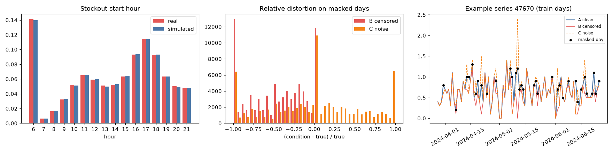

# Step 3 report: training-data conditions

Config: `{"mask_rate": 0.3, "demand_power": 1.0, "seed": 42}`

## Masking

- Candidate days (clean train days): 263,673; masked: 78,998 (30.0% of candidates, target 30%)
- Effective censoring: 66,421 masked days (25.2% of candidates) actually lose sales; the other 15.9% of masked days had no sales after the simulated stockout hour, so censoring leaves them unchanged (in B and C alike).
- Masked share per series: median 29.8%, 5th-95th pct 20.4% to 40.0%
- [PASS] overall masked share within 1 point of target
- [PASS] only clean train days are masked (no stockout days, no test days)
- Demand link: masked days had true sales 1.27x their series' clean-day mean; unmasked clean days 0.88x
- [PASS] masked days are higher-demand days on average

## Simulated stockout hour vs real pattern

- Total variation distance between simulated and real start-hour distributions: 0.005
- [PASS] simulated stockout hours follow the real distribution (TVD < 0.02)

## Distortion on masked days (truth = condition A)

| condition | mean abs. distortion | relative (sum abs / sum true) | bias (sum signed / sum true) | days changed |
|---|---|---|---|---|
| A clean | 0.000 | 0.0% | +0.0% | 0.0% |
| B censored | 0.538 | 45.9% | -45.9% | 89.0% |
| C matched noise | 0.538 | 45.9% | +0.1% | 89.0% |
- [PASS] A equals the truth everywhere
- [PASS] B never exceeds the truth (censoring is one-sided)
- [PASS] C has exactly the same absolute distortion as B on every masked day
- [PASS] C is never negative
- [PASS] C is roughly unbiased (|bias| < 3%)
- [PASS] all unmasked days (real stockout days and the test week) are identical in A, B and C

## Effect on the whole training set

- sales_A: total train sales 100.0% of A; zero-sale days 4.3%
- sales_B: total train sales 90.0% of A; zero-sale days 7.1%
- sales_C: total train sales 100.0% of A; zero-sale days 5.7%

## Summary

ALL CHECKS PASSED