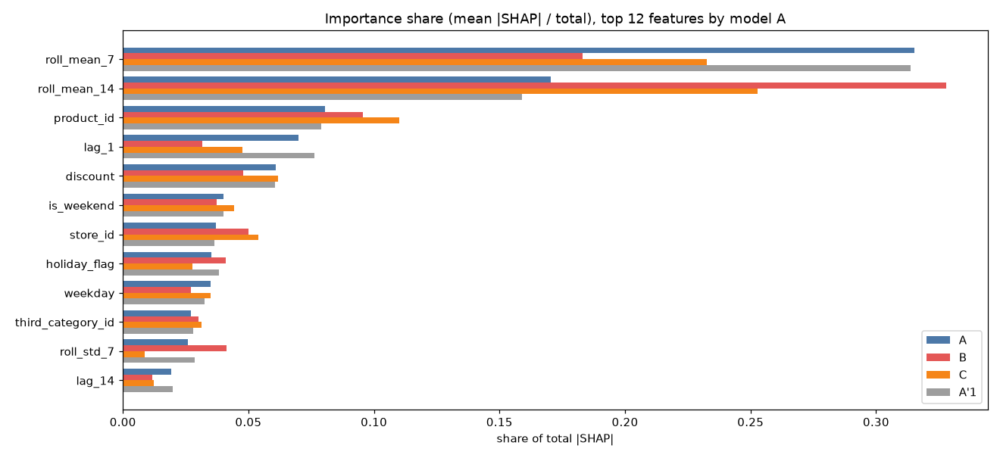
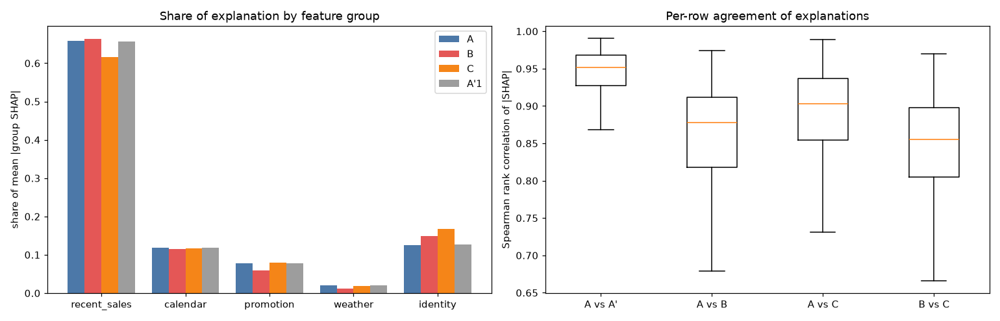

# Step 7 report: SHAP explanations

- Explained rows: the same 2,000 clean test rows for every model (76% low-sales, 1,690 series, 678 stores).
- Explainer: TreeExplainer, exact, `tree_path_dependent`. It uses each model's own trees, so no background sample is needed, and it supports LightGBM's categorical splits (the interventional mode with a background sample does not). SHAP values are relative to each model's own base value (its average training prediction).
- Noise floor: 3 reference models (A'1, A'2, A'3) = condition A retrained with seeds [43, 44, 45]. Any change smaller than A vs A' is indistinguishable from retraining noise.
- SHAP shows what each model relies on, not what causes sales.

## Checks

- [PASS] A: base value + sum of SHAP = model prediction (additivity)
- [PASS] B: base value + sum of SHAP = model prediction (additivity)
- [PASS] C: base value + sum of SHAP = model prediction (additivity)
- [PASS] A'1: base value + sum of SHAP = model prediction (additivity)
- [PASS] A'2: base value + sum of SHAP = model prediction (additivity)
- [PASS] A'3: base value + sum of SHAP = model prediction (additivity)
- [PASS] A: explained model reproduces the Step 6 test forecasts
- [PASS] B: explained model reproduces the Step 6 test forecasts
- [PASS] C: explained model reproduces the Step 6 test forecasts
- [PASS] no tied |SHAP| values within a row (rank-based stability measures are well defined)

## 1. Global importance

Raw = mean |SHAP| in sales units. Share = raw / sum over all features (scale-free). Use **share** to compare models: B forecasts lower overall, so its SHAP values are smaller everywhere (mean total |SHAP| per row: A 0.919, B 0.762, C 0.915, A'1 0.929).

| rank (A) | feature | group | raw A | raw B | raw C | share A | share B | share C | share A' (mean) |
|---|---|---|---|---|---|---|---|---|---|
| 1 | roll_mean_7 | recent_sales | 0.2897 | 0.1395 | 0.2126 | 31.5% | 18.3% | 23.3% | 29.8% |
| 2 | roll_mean_14 | recent_sales | 0.1567 | 0.2499 | 0.2311 | 17.1% | 32.8% | 25.3% | 18.3% |
| 3 | product_id | identity | 0.0740 | 0.0729 | 0.1007 | 8.0% | 9.6% | 11.0% | 8.1% |
| 4 | lag_1 | recent_sales | 0.0642 | 0.0241 | 0.0435 | 7.0% | 3.2% | 4.8% | 7.0% |
| 5 | discount | promotion | 0.0559 | 0.0366 | 0.0566 | 6.1% | 4.8% | 6.2% | 6.1% |
| 6 | is_weekend | calendar | 0.0368 | 0.0284 | 0.0406 | 4.0% | 3.7% | 4.4% | 4.1% |
| 7 | store_id | identity | 0.0341 | 0.0382 | 0.0492 | 3.7% | 5.0% | 5.4% | 3.7% |
| 8 | holiday_flag | calendar | 0.0324 | 0.0312 | 0.0254 | 3.5% | 4.1% | 2.8% | 3.7% |
| 9 | weekday | calendar | 0.0321 | 0.0207 | 0.0320 | 3.5% | 2.7% | 3.5% | 3.3% |
| 10 | third_category_id | identity | 0.0249 | 0.0230 | 0.0286 | 2.7% | 3.0% | 3.1% | 2.7% |
| 11 | roll_std_7 | recent_sales | 0.0239 | 0.0316 | 0.0079 | 2.6% | 4.1% | 0.9% | 2.9% |
| 12 | lag_14 | recent_sales | 0.0176 | 0.0088 | 0.0113 | 1.9% | 1.2% | 1.2% | 1.8% |
| 13 | lag_2 | recent_sales | 0.0140 | 0.0127 | 0.0154 | 1.5% | 1.7% | 1.7% | 1.6% |
| 14 | lag_7 | recent_sales | 0.0140 | 0.0130 | 0.0115 | 1.5% | 1.7% | 1.3% | 1.4% |
| 15 | activity_flag | promotion | 0.0136 | 0.0067 | 0.0122 | 1.5% | 0.9% | 1.3% | 1.5% |
| 16 | avg_temperature | weather | 0.0099 | 0.0042 | 0.0095 | 1.1% | 0.6% | 1.0% | 1.1% |
| 17 | second_category_id | identity | 0.0067 | 0.0063 | 0.0065 | 0.7% | 0.8% | 0.7% | 0.8% |
| 18 | precpt | weather | 0.0059 | 0.0043 | 0.0056 | 0.6% | 0.6% | 0.6% | 0.7% |
| 19 | avg_humidity | weather | 0.0058 | 0.0025 | 0.0065 | 0.6% | 0.3% | 0.7% | 0.6% |
| 20 | city_id | identity | 0.0026 | 0.0020 | 0.0032 | 0.3% | 0.3% | 0.3% | 0.3% |
| 21 | first_category_id | identity | 0.0022 | 0.0022 | 0.0013 | 0.2% | 0.3% | 0.1% | 0.3% |
| 22 | avg_wind_level | weather | 0.0019 | 0.0031 | 0.0032 | 0.2% | 0.4% | 0.4% | 0.2% |

- Top 5 in A: roll_mean_7, roll_mean_14, product_id, lag_1, discount
- Top 5 in B: roll_mean_14, roll_mean_7, product_id, store_id, discount
- Top 5 in C: roll_mean_14, roll_mean_7, product_id, discount, store_id
- Top 5 in A'1: roll_mean_7, roll_mean_14, product_id, lag_1, discount

## 2. Feature groups (share of mean |group SHAP|)

| group | A | B | C | A' (mean) |
|---|---|---|---|---|
| recent_sales | 65.9% | 66.4% | 61.6% | 65.6% |
| calendar | 11.8% | 11.5% | 11.6% | 11.9% |
| promotion | 7.8% | 6.0% | 8.0% | 7.9% |
| weather | 2.0% | 1.2% | 1.9% | 2.0% |
| identity | 12.6% | 14.8% | 16.8% | 12.7% |

Group ranking identical in every model: True. (With only 5 groups a rank correlation is too coarse to be informative, so groups are compared by share only.)

## 3. Stability of the global feature ranking (22 features)

| comparison | Spearman | Kendall | top-5 overlap |
|---|---|---|---|
| A vs A' (mean of 3) | 0.993 | 0.957 | 100% |
| A vs B | 0.945 | 0.801 | 80% |
| A vs C | 0.960 | 0.844 | 80% |
| B vs C | 0.906 | 0.784 | 100% |

## 4. Stability of per-row explanations (same row, two models)

| comparison | mean per-row Spearman (95% CI) | mean top-3 overlap | rows with identical top-3 |
|---|---|---|---|
| A vs A' (mean of 3) | 0.944 (0.942-0.945) | 0.91 | 75% |
| A vs B | 0.857 (0.853-0.861) | 0.76 | 38% |
| A vs C | 0.887 (0.884-0.891) | 0.81 | 48% |
| B vs C | 0.839 (0.834-0.843) | 0.83 | 55% |

Paired test, same rows: (A vs C) minus (A vs B) agreement = +0.031 (95% CI +0.026 to +0.034); censoring disagrees with A more than noise on 69% of rows. The CI excludes 0: censoring changes explanations significantly more than matched noise.

## 5. Drift of focus features: change in importance share vs A

| feature | B vs A | C vs A | A' vs A (range over seeds) |
|---|---|---|---|
| lag_1 | -55% | -32% | -7% to +9% |
| lag_7 | +12% | -17% | -27% to +23% |
| roll_mean_7 | -42% | -26% | -12% to -0% |
| roll_mean_14 | +92% | +48% | -7% to +19% |
| discount | -21% | +2% | -2% to +2% |
| activity_flag | -40% | -9% | +0% to +12% |
| weekday | -22% | +0% | -7% to -1% |
| holiday_flag | +16% | -21% | +0% to +9% |

## 6. Promotion levers: signed contribution (sales units) and relative to the model's base value

Discounted rows: 993; activity rows: 586.

| model | base value | discount SHAP on discounted rows | as % of base | activity_flag SHAP on activity rows | as % of base |
|---|---|---|---|---|---|
| A | 0.966 | +0.0523 | +5.4% | +0.0180 | +1.9% |
| B | 0.800 | +0.0337 | +4.2% | +0.0094 | +1.2% |
| C | 0.967 | +0.0523 | +5.4% | +0.0167 | +1.7% |
| A'1 | 0.967 | +0.0526 | +5.4% | +0.0175 | +1.8% |
| A'2 | 0.966 | +0.0514 | +5.3% | +0.0205 | +2.1% |
| A'3 | 0.967 | +0.0531 | +5.5% | +0.0183 | +1.9% |

## 7. Accuracy change vs explanation change

| comparison | WAPE change | explanation change (1 - per-row Spearman) | x noise floor |
|---|---|---|---|
| A vs B | +9.6% | 0.143 | 2.6x |
| A vs C | +3.2% | 0.113 | 2.0x |
| A vs A' | (retrain only) | 0.056 | 1.0x |

## Summary

ALL CHECKS PASSED

Done in 22s.