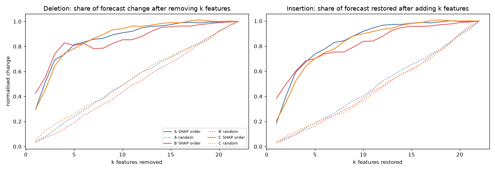
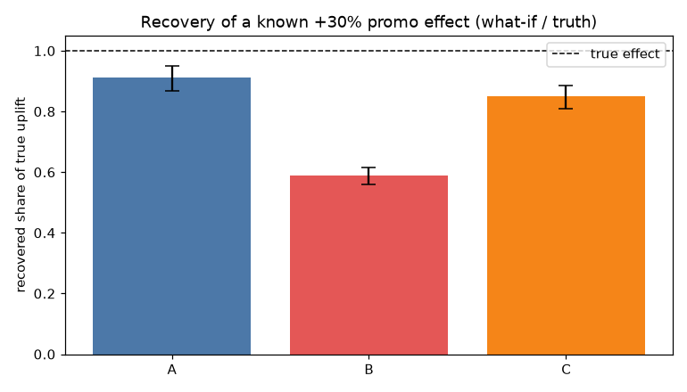

# Step 8 report: faithfulness of SHAP explanations

## Part 1: deletion and insertion curves

500 of Step 7's explained rows. Removed features are set to condition A's training median (numeric) or most frequent value (categorical). Random order = average of 5 random orders. Score = area under the normalised curve (0-1, higher = forecast moves faster = explanation more faithful).

| model | rows used | deletion: SHAP order | deletion: random | gain (95% CI) | insertion: SHAP order | insertion: random | gain (95% CI) |
|---|---|---|---|---|---|---|---|
| A | 490 | 0.855 | 0.540 | +0.315 (+0.282 to +0.342) | 0.837 | 0.495 | +0.343 (+0.310 to +0.369) |
| B | 487 | 0.849 | 0.522 | +0.327 (+0.301 to +0.351) | 0.836 | 0.495 | +0.341 (+0.315 to +0.365) |
| C | 489 | 0.882 | 0.539 | +0.343 (+0.315 to +0.369) | 0.848 | 0.485 | +0.363 (+0.337 to +0.386) |

- [PASS] A: SHAP order beats random order in both deletion and insertion (CI above 0)
- [PASS] B: SHAP order beats random order in both deletion and insertion (CI above 0)
- [PASS] C: SHAP order beats random order in both deletion and insertion (CI above 0)

## Part 2: injected promotion with a known effect (+30% on 20% of days)

- Masking in condition B: 36.4% of injected-promo clean train days vs 28.3% of other clean train days (demand-linked masking hits promo days harder, as real stockouts would).
- Test rows: 20,996 clean test days, of which 4,134 have the injected promo. True mean uplift on those rows: 0.3292 units (= 30% of demand without promo).

What-if = forecast with test_promo=1 minus forecast with test_promo=0, compared with the true uplift. SHAP is relative to the model's average forecast, which already includes promo days (20%), so its yardstick is (1 - 20%) x true uplift.

| model | test WAPE | what-if uplift (mean) | recovery (what-if / true) | SHAP of test_promo (mean) | recovery (SHAP / expected SHAP) | rank of test_promo in SHAP |
|---|---|---|---|---|---|---|
| A | 0.290 | +0.2998 | 91% (87%-95%) | +0.2257 | 87% | 2 of 23 |
| B | 0.322 | +0.1942 | 59% (56%-61%) | +0.1423 | 55% | 2 of 23 |
| C | 0.298 | +0.2800 | 85% (81%-89%) | +0.2139 | 82% | 2 of 23 |

- [PASS] A (clean) recovers the injected effect within +/-20% (the method works when data are clean)
- [PASS] B (censored) recovers less of the effect than A
- B under-recovers the true promo effect by 35% relative to A; C differs from A by -7%.

## Summary

ALL CHECKS PASSED

Done in 50s.