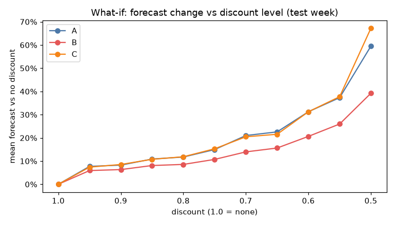
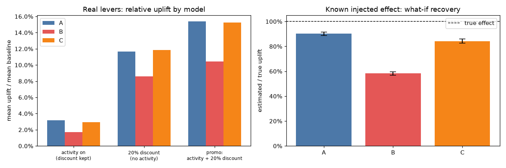

# Step 9 report: what-if on the promotion levers

A what-if shows how a model's forecast responds to a planned change; it is not a causal estimate. Only discount and activity_flag (and the synthetic test_promo) can be changed; sales history cannot.

## Guard rails

- [PASS] what-if refuses changing past sales (lag_1)
- [PASS] what-if refuses changing a rolling mean
- [PASS] what-if refuses discount below training support (0.3)
- [PASS] what-if refuses non-binary activity_flag

## Part 1: real levers (discount, activity_flag)

- [PASS] forecasts with unchanged inputs equal Step 6's saved forecasts

20,996 clean test days. Uplift = forecast(scenario) - forecast(baseline); relative uplift = mean uplift / mean baseline forecast. True effect is unknown for real levers, so B and C are compared with A. CI = 95% bootstrap over stores.

| scenario | model | mean baseline | mean uplift | relative uplift | ratio to A (95% CI) | rows with negative uplift |
|---|---|---|---|---|---|---|
| activity on (discount kept) | A | 1.069 | +0.034 | +3.2% | - | 5.7% |
| activity on (discount kept) | B | 0.948 | +0.016 | +1.7% | 0.48 (0.47-0.49) | 11.4% |
| activity on (discount kept) | C | 1.055 | +0.031 | +2.9% | 0.91 (0.89-0.93) | 7.3% |
| 20% discount (no activity) | A | 1.001 | +0.117 | +11.7% | - | 2.1% |
| 20% discount (no activity) | B | 0.903 | +0.078 | +8.6% | 0.66 (0.65-0.68) | 4.1% |
| 20% discount (no activity) | C | 0.988 | +0.117 | +11.8% | 1.00 (0.99-1.01) | 2.5% |
| promo: activity + 20% discount | A | 1.001 | +0.154 | +15.4% | - | 1.4% |
| promo: activity + 20% discount | B | 0.903 | +0.094 | +10.4% | 0.61 (0.60-0.62) | 3.6% |
| promo: activity + 20% discount | C | 0.988 | +0.150 | +15.2% | 0.98 (0.96-0.99) | 2.0% |

Relative uplift by sales group (scenario: promo = activity + 20% discount):

| group | A | B | C |
|---|---|---|---|
| low | +22.6% | +15.9% | +22.6% |
| high | +9.3% | +5.8% | +9.0% |

- Descriptive reference (not causal): in condition A's clean training days, the median series sells +36% more on activity days than on non-activity days. Activity days also carry deeper discounts and other differences, so this is only a rough sanity check for the 'promo' scenario.

Discount curve (activity kept at each row's value), mean forecast relative to no discount:

| discount | A | B | C |
|---|---|---|---|
| 1.00 | +0.0% | +0.0% | +0.0% |
| 0.95 | +7.7% | +5.9% | +7.4% |
| 0.90 | +8.3% | +6.3% | +8.5% |
| 0.85 | +10.9% | +8.1% | +10.8% |
| 0.80 | +11.7% | +8.6% | +11.9% |
| 0.75 | +15.0% | +10.7% | +15.3% |
| 0.70 | +21.0% | +14.0% | +20.5% |
| 0.65 | +22.6% | +15.6% | +21.6% |
| 0.60 | +31.2% | +20.6% | +31.2% |
| 0.55 | +37.3% | +26.0% | +37.7% |
| 0.50 | +59.5% | +39.2% | +67.2% |

- [PASS] A forecasts more demand under a promo than without one (expected direction)
- A's promo uplift (+15.4%) is smaller than the descriptive gap (+36%). Expected: the raw gap also contains whatever else differs on activity days (product mix, season, deeper discounts), which the model attributes to other features. The raw gap is not a target to match.
- Discounts below 0.60 are rare in training (2.1% of rows), so the curve's last points rest on little data; the jump at 0.50 should not be trusted.
- Promo scenario: B's uplift is 61% of A's (CI 60%-62%); C's is 98%.

## Part 2: what-if error against a known effect (injected promo, +30% on 20% of days)

All 20,996 clean test days: estimated uplift = forecast(test_promo=1) - forecast(test_promo=0); true uplift = 30% of the demand without promo. Error = estimated - true (negative = under-estimate).

| model | mean true uplift | mean estimated uplift | recovery (95% CI) | mean error | MAE of error | rows under-estimated |
|---|---|---|---|---|---|---|
| A | 0.3379 | 0.3053 | 90% (89%-92%) | -0.0326 | 0.1158 | 53% |
| B | 0.3379 | 0.1969 | 58% (57%-60%) | -0.1409 | 0.1689 | 77% |
| C | 0.3379 | 0.2847 | 84% (82%-86%) | -0.0532 | 0.1316 | 57% |

Recovery by sales group:

| group | A | B | C |
|---|---|---|---|
| low | 93% | 64% | 90% |
| high | 88% | 53% | 79% |

- [PASS] A recovers the known effect within +/-20% on all clean test days
- [PASS] B recovers significantly less than A (CIs do not overlap)

## Summary

ALL CHECKS PASSED

Done in 46s.